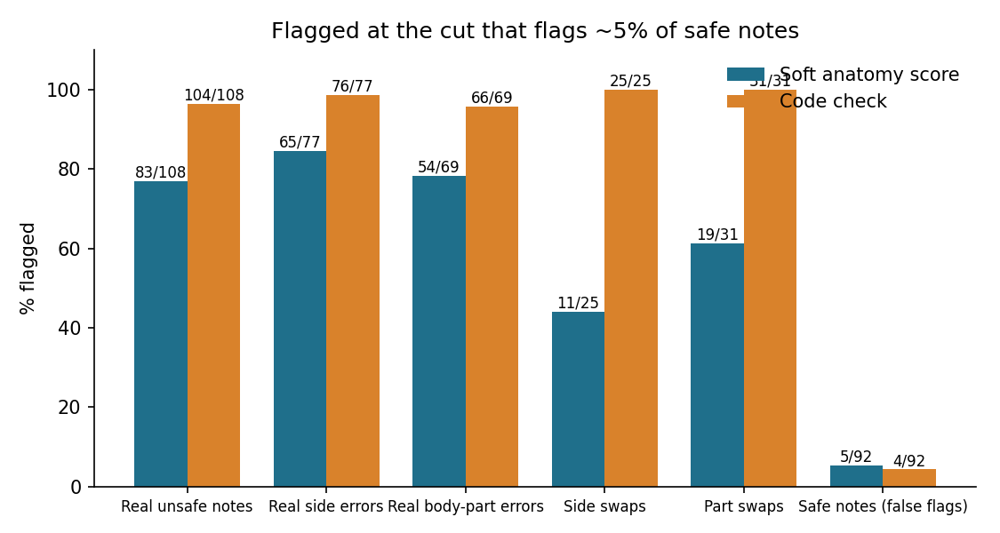

# Soft anatomy matching vs wrong sides and body parts

**Paper:** Zhao, Wu, Zhang, Zhang, Wang and Xie, *RaTEScore: A Metric for Radiology Report Generation*, 2024 ([arXiv:2406.16845](https://arxiv.org/abs/2406.16845)).

RaTEScore pulls medical entities out of a generated report and its reference (anatomy, abnormality, disease and their negated forms), embeds each entity with BioLORD-2023-C, matches every entity to its most similar entity on the other side, and takes the harmonic mean of the two directions. It agreed with radiologists better than BLEU, ROUGE-L, BERTScore and RadGraph F1 on its own RaTE-Eval set and on ReXVal. The paper does not discuss left and right, and its data is English radiology reports.

**Research question:** In my Roman Urdu SOAP benchmark the most common errors were a wrong or missing injured side and a wrong body part. Does RaTEScore-style soft matching of anatomy notice these errors, or does it score "left knee" almost the same as "right knee"? And how does it compare with a plain code check?

This is **not** RaTEScore itself: there is no NER model and no learned type weights. Anatomy phrases ("right ankle", "lower back") are read with the word lists from [`side-mismatch-check/`](../side-mismatch-check/) and scored with the same encoder the paper uses (BioLORD-2023-C, Eqs. 1-3 without weights). No LLM is called.

## What runs
| Part | Input | Question |
|---|---|---|
| Probe | 10 fixed phrase pairs | How similar does the encoder find a side swap, a body-part swap, a synonym? |
| Notes | the same 200 notes as [`side-mismatch-check/`](../side-mismatch-check/) (40 English, 160 Roman Urdu) | Does the soft score separate unsafe notes from safe ones? |
| Swaps | every safe English note with left and right swapped, and with its main body part swapped (knee to ankle, shoulder to elbow, back to neck) | Does the score drop when only the side or the part changes? |

**Reference label:** a note is unsafe if the side is missing, wrong or not in the transcript (as in `side-mismatch-check/`), the main body region is missing, or it names a region the English transcript never mentions.

**Soft score flag:** a note is flagged when its score is below the cut that flags about 5% of safe notes. **Code check:** flags a note when its side words or body regions disagree with the spoken transcript (no encoder).

## Run
```bash
python3 -m venv .venv && source .venv/bin/activate
pip install -r requirements.txt
python -m pytest -q          # 7 offline tests (letter-count stand-in encoder)
python entity_match.py       # first run downloads BioLORD-2023-C (about 0.4 GB), then about a minute
```

## Results
From my run on a MacBook M4 (16 GB), BioLORD-2023-C on CPU. No model is sampled, so a rerun gives the same numbers. The cut (soft score 0.797) flags 5 of the 92 safe notes.

**Encoder similarity** ([`results/probe.csv`](results/probe.csv), 1 = identical):

| Pair | Kind | Cosine |
|---|---|---|
| right knee / left knee | side swap | 0.770 |
| right ankle / left ankle | side swap | 0.748 |
| left shoulder / right shoulder | side swap | 0.717 |
| right knee / right patella | synonym | 0.767 |
| lower back / lumbar spine | synonym | 0.596 |
| left shoulder / left elbow | part swap | 0.586 |
| right ankle / right knee | part swap | 0.504 |
| lower back / neck | part swap | 0.388 |
| knee / headache | unrelated | 0.268 |

**Notes and swaps** ([`results/summary.csv`](results/summary.csv)):

| Set | Notes | Soft score flagged | Code check flagged |
|---|---|---|---|
| Real unsafe notes | 108 | 83 | 104 |
| of which side errors | 77 | 65 | 76 |
| of which body-part errors | 69 | 54 | 66 |
| Side swaps (safe English notes) | 25 | 11 | 25 |
| Part swaps (safe English notes) | 31 | 19 | 31 |
| Safe notes (false flags) | 92 | 5 | 4 |

AUROC of the soft score on the real notes is 0.955 (mean 0.638 unsafe vs 0.961 safe). Swapping only the sides lowered the score by 0.17 on average, swapping the body part by 0.27.



**Main finding:** to this encoder a wrong side looks like a near-synonym. "Right knee" vs "left knee" (0.770) is as close as "right knee" vs "right patella" (0.767) and closer than "lower back" vs "lumbar spine" (0.596). The soft score did well on the real notes (AUROC 0.955) mainly because many unsafe notes also lost or changed a whole body part, but it flagged only 11 of 25 notes where nothing changed except the side.

## My notes
- BioLORD gave right knee vs left knee 0.77 and the other side swaps 0.72 and 0.75. That is higher than lower back vs lumbar spine (0.596), which mean the same thing. For a physiotherapist this means a score built on these embeddings treats a wrong side almost like a synonym.
- When I swapped only the sides in 25 safe English notes, the soft score fell below the cut in 11. A real case: in C7 (llama3.1:8b, rule + glossary) the note says left elbow for a right elbow and still scores 0.92. The code check flagged every swap, but it uses the same word lists that made the swaps, so that part is expected. For the side I would trust the code check, and use a soft score only as a second signal.
- The soft score's 5 false flags were not synonym problems. In C3 the consultation also mentions the arm and head, so a safe note that only says "left shoulder" scored 0.72 because it left those out. The score also punishes a short but safe note.

## Article
[A medical similarity metric scores "left knee" closer to "right knee" than "lumbar spine" to "lower back"](https://masmatixinnovations.co.uk/insights/soft-anatomy-match-roman-urdu.html)

## Limitations
- RaTEScore-style, not RaTEScore: no entity extractor model, no learned weights, anatomy entities only. A full RaTEScore run could rank notes differently.
- The phrases come from word lists, so a body part written in an unusual way is missed by both the soft score and the code check.
- The reference label uses the same word lists as the code check, so the code check has a built-in advantage on the real notes; the swap test does not have this problem, because the error is known by construction.
- BioLORD-2023-C has no sentence-transformers wrapper, so it loads with mean pooling and a warning; the model owner says this is the correct behaviour. Embeddings are normalised before the cosine.
- 20 fictional consultations, one run of notes per condition, one author labelling.
