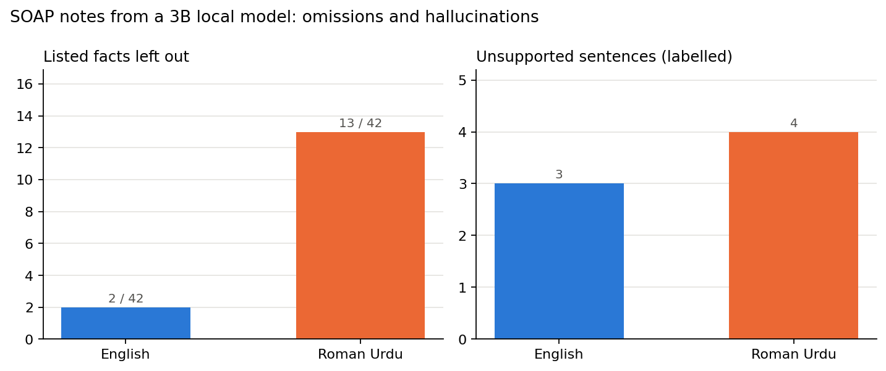

# Hallucinations and omissions in SOAP notes from a small local model

**Research question:** When a ~3B local model drafts physiotherapy SOAP notes from consultation transcripts, how many key facts does it leave out and how many sentences does it add without support, and is this worse when the consultation is in Roman Urdu?

## Paper this follows
Asgari E., Montaña-Brown N., Dubois M., Khalil S., Balloch J., Au Yeung J., Pimenta D. (2025). *A framework to assess clinical safety and hallucination rates of LLMs for medical text summarisation.* npj Digital Medicine 8, 274. [doi:10.1038/s41746-025-01670-7](https://doi.org/10.1038/s41746-025-01670-7) ([preprint](https://www.medrxiv.org/content/10.1101/2024.09.12.24313556))

They had clinicians label 12,999 sentences of GPT-4 notes written from 450 simulated UK primary-care consultations (English). They found a 1.47% hallucination rate and a 3.45% omission rate; 44% of hallucinations were major, most often in the Plan. Their limitations: one model (GPT-4), English only, and expensive manual labelling. This experiment asks the same question for a small model that runs on a laptop, in English and Roman Urdu.

## Setup
- **Model:** `qwen2.5:3b` through Ollama (temperature 0, seed 42). Another model can be passed with `--model`.
- **Data:** 4 short fictional physiotherapy consultations I wrote (`data/consultations.json`): low back pain, twisted knee, stiff shoulder with diabetes, neck pain from desk work. Each one exists in English and in Roman Urdu with the same facts and digits, so 8 notes in total. No real patient data.
- **Prompt:** write a concise English SOAP note (Subjective, Objective, Assessment, Plan) using only information in the transcript.
- **Omissions (automatic):** each consultation has 10-11 listed facts, some marked *critical* (red-flag answers, medication, side, referrals). A fact counts as missing if its keyword pattern is absent from the note.
- **Hallucinations (my labels):** the checker flags note sentences with a number or drug name not in the transcript, or a denied symptom stated without a negation. Every Plan sentence is also reviewed, because the paper found most major hallucinations there. I label each reviewed sentence with `label.py` as `ok` or `H` (unsupported), and each `H` as `major` (could change diagnosis or management) or `minor`, following the paper's definition.

## Run
```bash
python3 -m venv .venv && source .venv/bin/activate
pip install -r requirements.txt
python -m pytest -q        # offline tests for the checker
python run.py              # drafts 8 notes, writes results/review.csv
python label.py            # label each reviewed sentence in the terminal (o/h, then m/n)
python summarise.py        # writes results/summary.csv and the chart
```

## Results
From my run on a MacBook M4 (16 GB).

| Language | Notes | Listed facts missing | Critical facts missing | Sentences reviewed | Unsupported sentences | Major |
|---|---|---|---|---|---|---|
| English | 4 | _ / _ | _ | _ | _ | _ |
| Roman Urdu | 4 | _ / _ | _ | _ | _ | _ |



## My notes
_To be added after labelling._

## Limitations
- 8 notes from 4 consultations I wrote and one model at temperature 0. A pilot, not a benchmark.
- Omission checks are keyword based: a fact written with unexpected words counts as missing, and a fact stated wrongly (for example a denied symptom written as present) still counts as present. The negation flag is there to catch the second case.
- Only flagged and Plan sentences are labelled, so unsupported sentences elsewhere without a number, drug or denied symptom can be missed.
- I labelled the sentences myself; the paper used two clinicians per note and a senior reviewer.
- Transcripts are clean text. Real notes would start from speech-to-text, which adds its own errors (see [`whisper-urdu-wer/`](../whisper-urdu-wer/)).

## Next steps
- Label every sentence for a subset to measure what the checker misses.
- Compare `llama3.1:8b`, and test the paper's best prompt ideas (a template and a revision step) on the same notes.
- Feed Whisper transcripts instead of clean text and measure how transcript errors change the note.
