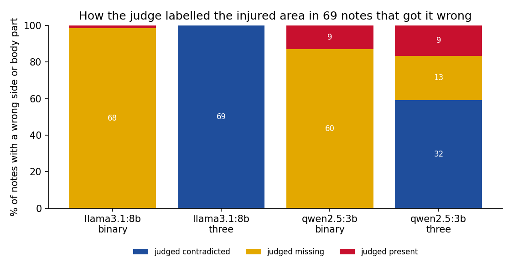

# A third label for the local omission judge: contradicted

**Research question:** MED-OMIT and my local omission judge ([`llm-omission-judge/`](../llm-omission-judge/)) can only say a fact is present or missing. A note that writes "left knee" for a right knee, or "no swelling" when the knee swelled, has no label of its own, and in my earlier run a judge passed such a note as present. If `qwen2.5:3b` and `llama3.1:8b` may also answer "contradicted", how many notes with a wrong side or wrong body part do they catch, how many correct notes do they wrongly call contradicted, and does the extra label make them hide more missing red flags?

This tests gap G12 in [`gap-bank.md`](../gap-bank.md).

## The paper
Schumacher, E., Rosenthal, D., Nair, V., Price, L., Tso, G. and Kannan, A. *MED-OMIT: Extrinsically-Focused Evaluation of Omissions in Medical Summarization.* arXiv:2311.08303 (2023), [arxiv.org/abs/2311.08303](https://arxiv.org/abs/2311.08303). MED-OMIT labels each fact of a consultation as present or omitted in the summary; a fact stated wrongly is outside its scale.

## Design
- **Notes (200, none drafted here):** 80 notes from [`roman-urdu-soap-benchmark/`](../roman-urdu-soap-benchmark/) (20 cases x English/Roman Urdu x 2 models) and 120 Roman Urdu notes from [`injured-side-rule/`](../injured-side-rule/) (rule, rule + glossary and retry conditions x 2 models x 20 cases). The side-rule notes are included because they hold most of the wrong sides.
- **Facts:** the case facts I wrote, plus one critical "injured area" fact per case built from the case's body region and side (for example "injured area: right ankle or foot"). C2 and C3 already list it as "side".
- **Two prompts, same judges:** `binary` is the prompt from `llm-omission-judge/` word for word (present / missing). `three` adds "contradicted" for the other side, a different body part, a different number or dose, or absent when it was present.
- **Judges:** `qwen2.5:3b` and `llama3.1:8b` through Ollama, temperature 0, seed 42, output capped at 400 tokens. One call per note with all of its facts; one retry if the reply is not usable JSON. 200 notes x 2 judges x 2 prompts = 800 calls.
- **Reference for the injured-area fact (code, English words only):** contradicted if the note names the other side, or never names the injured region but names a region the English transcript does not have; missing if the region or the expected side is absent; present otherwise. On the 200 notes this gives 69 contradicted (36 side, 33 body part), 30 missing and 101 present. All 69 contradicted notes are Roman Urdu.
- **Red flags:** for critical facts the keyword checker calls missing, I count how often each prompt calls them present ("hidden"), paired by note and fact, with an exact McNemar test.
- **Other contradictions:** there is no code reference for facts like "no swelling", so every "contradicted" call on another fact goes into a pool and 40 of them (fixed seed) go into `results/to_label.csv` for my own labels.

## Run
```bash
python3 -m venv .venv && source .venv/bin/activate
pip install -r requirements.txt
python -m pytest -q                         # 10 offline tests with a scripted fake judge
caffeinate -i python contradiction_judge.py # 800 calls; prints progress and ETA; safe to stop and restart
python analysis.py                          # no model needed; writes results/
# after filling my_label (contradicted, missing, present or unclear) in results/to_label.csv:
python analysis.py --score-labels
```

Outputs in `results/`: `runs.jsonl` (every call, with the raw reply), `area_fact.csv`, `summary.csv` (with 95% Wilson intervals), `critical.csv`, `results.json`, `to_label.csv` and `area_fact.png`.

## Results
One run on a MacBook M4 (16 GB), temperature 0, seed 42. Full tables in `results/`.

**Usable replies.** Both judges gave usable JSON for all 200 binary calls. With three labels, llama3.1:8b gave 200 of 200 but qwen2.5:3b only 141 of 200 (70.5%, 95% CI 64-76%). In the 17 failed replies I read, it sent a plain list such as `["present", "present", ...]` instead of the numbered object, often with the wrong number of labels. Calls are deterministic at temperature 0, so running them again gives the same reply. The qwen2.5:3b three-label rows below cover these 141 calls only.

**Injured-area fact: how each judge labelled each kind of note**

| Judge | Prompt | Reference | Notes | Present | Missing | Contradicted | Flagged (95% CI) |
|---|---|---|---|---|---|---|---|
| llama3.1:8b | binary | contradicted | 69 | 1 | 68 | - | 68 (92-100%) |
| llama3.1:8b | three | contradicted | 69 | 0 | 0 | 69 | 69 (95-100%) |
| llama3.1:8b | binary | missing | 30 | 7 | 23 | - | 23 (59-88%) |
| llama3.1:8b | three | missing | 30 | 2 | 0 | 28 | 28 (79-98%) |
| llama3.1:8b | binary | present | 101 | 65 | 36 | - | 36 (27-45%) |
| llama3.1:8b | three | present | 101 | 43 | 2 | 56 | 58 (48-67%) |
| qwen2.5:3b | binary | contradicted | 69 | 9 | 60 | - | 60 (77-93%) |
| qwen2.5:3b | three | contradicted | 54 | 9 | 13 | 32 | 45 (71-91%) |
| qwen2.5:3b | binary | missing | 30 | 15 | 15 | - | 15 (33-67%) |
| qwen2.5:3b | three | missing | 20 | 10 | 3 | 7 | 10 (30-70%) |
| qwen2.5:3b | binary | present | 101 | 81 | 20 | - | 20 (13-29%) |
| qwen2.5:3b | three | present | 67 | 58 | 4 | 5 | 9 (7-24%) |

"Flagged" means missing or contradicted. Paired on the same notes (exact McNemar), the third label did not change how many wrong notes llama3.1:8b flagged (68 vs 69, p = 1.0), but it flagged more correct notes (36 vs 58 of 101, p = 4.8e-7). llama3.1:8b also called 28 of 30 missing injured areas "contradicted". For qwen2.5:3b no difference was significant.



**Missing critical facts the judge called present (hidden)**

| Judge | Critical facts missing by keywords | Hidden, binary | Hidden, three labels | McNemar p | Called contradicted |
|---|---|---|---|---|---|
| llama3.1:8b | 224 | 98 | 86 | 0.0005 | 122 |
| qwen2.5:3b | 177 | 81 | 77 | 0.52 | 58 |

**"Contradicted" on other facts: my labels.** The three-label judges called 363 other facts contradicted (llama3.1:8b 236, qwen2.5:3b 127). I labelled a random 40 of them (seed 7) against the note:

| Judge | Labelled | Really contradicted | Really missing | Really present (false alarm) |
|---|---|---|---|---|
| llama3.1:8b | 23 | 5 | 11 | 7 |
| qwen2.5:3b | 17 | 3 | 7 | 7 |
| Both | 40 | 8 (20%, 95% CI 11-35%) | 18 (45%) | 14 (35%, 95% CI 22-51%) |

So 26 of 40 "contradicted" calls pointed at a real problem in the note, but only 8 had the right label; most were omissions.

## My notes
1. With a third label, llama3.1:8b hid fewer missing critical facts (98 to 86 of 224, p = 0.0005) and named all 69 wrong injured areas as contradicted. The binary prompt had already flagged 68 of them, only as missing.
2. The cost was more false alarms: correct notes flagged went from 36 to 58 of 101.
3. qwen2.5:3b gave usable JSON for all 200 binary calls but only 141 of 200 three-label calls; in the failed replies I read, it sent a plain list instead of the numbered object.
4. Of 40 "contradicted" calls on other facts that I checked, only 8 were really contradicted; 18 were missing and 14 were correct in the note.
5. A local judge should not decide alone. I would use it as a flag next to code checks and a physiotherapist's review.

Article: [A third label helped a local AI name wrong body parts. Elsewhere, "contradicted" was right 8 times in 40](https://masmatixinnovations.co.uk/insights/contradiction-label-judge.html)

## Limitations
- 200 notes from the same 20 written consultations; one judge run at temperature 0.
- The reference for the injured-area fact reads English words only. A side or body part written only in copied Roman Urdu (for example "daayen takhne") counts as missing, which matches my earlier view that such a note is unsafe for a physiotherapist who does not read Roman Urdu, but a judge reading Roman Urdu may call it present.
- The reference is a keyword check and can be wrong; contradictions in other facts have no automatic reference and rely on my labels of 40 calls.
- All facts of a note go into one call, unlike MED-OMIT's one fact per call. The injured-area fact is added by me and is not part of MED-OMIT.
- Each judge also judges notes written by the same model, which may favour it.
- qwen2.5:3b three-label results cover only the 141 calls with usable JSON; the 59 failed calls may not be a random subset.
- I labelled 40 of 363 "contradicted" calls, alone and without a second rater.
