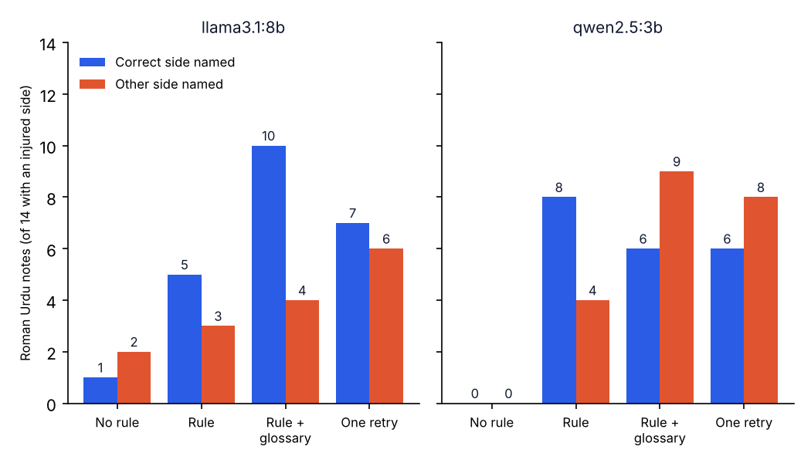

# A side rule for Roman Urdu SOAP notes

**Research question:** In the 20-consultation benchmark, two small local models dropped the injured side ("daayan", "baayan") from almost every Roman Urdu note (llama3.1:8b 13 of 14, qwen2.5:3b 14 of 14). Does a simple side rule bring it back, and does it cost anything: a wrong side, a side that was never said, or other facts lost?

This follows [`roman-urdu-soap-benchmark/`](../roman-urdu-soap-benchmark/) and uses its 20 consultations, note prompt and checks unchanged. Only the Roman Urdu transcripts are drafted.

## Conditions
| Condition | What changes |
|---|---|
| `baseline` | Nothing. The Roman Urdu notes from the benchmark run (same prompt, temperature 0, seed 42), reused, not drafted again. |
| `rule` | One sentence added to the prompt: write the side next to the body part whenever it is said. |
| `rule_glossary` | The rule plus a glossary line: daayan, daayen, dayan = right; baayan, baayen, bayan = left. |
| `retry` | The baseline note is checked. If the Roman Urdu transcript contains a side word and the note names no side, the model is asked once to rewrite the note with the side. If it is still missing, the note is marked incomplete for the physiotherapist. |

The retry check only reads the Roman Urdu transcript, as a real pipeline would. It does not know the right answer. This matters for C4 (neck pain): the transcript says "daayen kandhe tak" (spreading to the right shoulder) but there is no injured side, so the check fires there too.

**Measured:** side named (14 cases with an injured side), wrong side, a side the transcript does not support (all 20 cases), facts missing and critical facts missing (168 and 68 listed), wrong or missing body region, notes retried and still incomplete, and the benchmark safety gate. Each condition is compared with the baseline on the same case with an exact McNemar test on "side named".

## Run
```bash
python3 -m venv .venv && source .venv/bin/activate
pip install -r requirements.txt
python -m pytest -q          # offline tests (fake model)
python side_rule.py          # about 110 model calls, qwen2.5:3b and llama3.1:8b
python side_summary.py       # summary.csv, paired_tests.csv and the chart
```

## Results
From my run on a MacBook M4 (16 GB), one run at temperature 0.

| Model | Condition | Correct side named (of 14) | Other side named (of 14) | Side not said in transcript (of 20) | Facts missing (of 168) | Critical missing | Retried | Still incomplete | Gate flags (of 20) |
|---|---|---|---|---|---|---|---|---|---|
| qwen2.5:3b | baseline | 0 | 0 | 1 | 50 | 26 | - | 15 | 20 |
| qwen2.5:3b | rule | 8 | 4 | 6 | 54 | 28 | - | 2 | 18 |
| qwen2.5:3b | rule + glossary | 6 | 9 | 12 | 47 | 24 | - | 0 | 20 |
| qwen2.5:3b | retry | 6 | 8 | 9 | 49 | 25 | 15 | 0 | 18 |
| llama3.1:8b | baseline | 1 | 2 | 2 | 16 | 8 | - | 11 | 17 |
| llama3.1:8b | rule | 5 | 3 | 3 | 18 | 9 | - | 6 | 14 |
| llama3.1:8b | rule + glossary | 10 | 4 | 4 | 17 | 7 | - | 1 | 11 |
| llama3.1:8b | retry | 7 | 6 | 6 | 15 | 7 | 11 | 1 | 13 |

"Other side named" means the note names the side opposite to the injured one. "Side not said in transcript" counts every note that names a side the English transcript does not contain, over all 20 cases. Two qwen2.5:3b `rule` notes (C12, C18) reached the 1024-token cap.

Correct side named, each condition against the baseline on the same case (exact McNemar):

| Model | Condition | Fixed | Lost | p |
|---|---|---|---|---|
| qwen2.5:3b | rule | 8 | 0 | 0.0078 |
| qwen2.5:3b | rule + glossary | 6 | 0 | 0.0312 |
| qwen2.5:3b | retry | 6 | 0 | 0.0312 |
| llama3.1:8b | rule | 5 | 1 | 0.2188 |
| llama3.1:8b | rule + glossary | 9 | 0 | 0.0039 |
| llama3.1:8b | retry | 6 | 0 | 0.0312 |



**Main finding:** every condition made the models write a side more often, but also write the wrong side more often. The best result, llama3.1:8b with the glossary, named the correct side in 10 of 14 notes and the other side in 4. With qwen2.5:3b the glossary made things worse: the other side in 9 notes against the correct side in 6, and a side added to 3 cases with no injured side (C1, C16, C20). Facts missing hardly changed.

**Errors found by reading the notes** ([`results/notes.jsonl`](results/notes.jsonl)):
- **C3, llama3.1:8b, rule:** "pain in the right shoulder (baayan ka...)". The model copied the Roman Urdu word for left and still wrote right.
- **C19, llama3.1:8b, retry:** "the left leg (daayen pair tak)". The same error after being asked to add the side.
- **C14, qwen2.5:3b, retry:** the left knee replacement became a "right hip replacement".
- **C6, llama3.1:8b, retry:** left hip osteoarthritis became "osteoarthritis of the right lower back".

A check that only asks "is a side written?" would pass all of these notes. After the rule or retry, notes "still incomplete" fell to 0 to 2, while wrong sides rose.

## My notes
- A wrong side is more dangerous than a missing one. When the side is blank, the physiotherapist can see the gap and ask the patient again. When the note says "right shoulder" for a left shoulder (C3) or "left leg" next to "daayen pair tak" (C19), the note looks complete and can be trusted, and the wrong side may be examined or treated.
- The glossary helped llama3.1:8b (10 of 14 correct) but made qwen2.5:3b worse (9 wrong, and a side added in C1, C16 and C20 where there was none). My guess is that the smaller model does not map the words reliably and the rule pushes it to write some side anyway. One run cannot show why. The two notes cut at the token cap came from the plain rule, not the glossary.
- In MeetPhysio the side should not be left to the model. Code can read the side words in the transcript (daayan = right, baayan = left) and compare them with the note; if they do not match, or the note has no side, the note goes to the physiotherapist's review queue. The check must compare sides, not just demand one: in C4 the transcript says "daayen kandhe tak" (pain spreading to the right shoulder) with no injured side. This rule is a proposal and is not tested yet.

## Article
[Telling a local AI to write the injured side made it write the wrong side](https://masmatixinnovations.co.uk/insights/injured-side-rule-roman-urdu.html)

## Limitations
- Same 20 written consultations, one run per model at temperature 0. 14 cases have a side, so a change of a few notes is within chance; the McNemar p-values show this.
- Keyword checks. "Right" can be an ordinary word ("right away"), so a side can be counted as named when it is not.
- The glossary lists only the spellings in my transcripts. Real speakers also say "seedha" and "ulta", and Whisper may spell the words differently.
- New notes are capped at 1024 tokens (`num_predict`); the baseline notes had no cap. qwen2.5:3b kept generating on one note until a 5-minute timeout, three times in a row. Capped notes are kept, marked and counted in `cut_at_cap`.
- A side that is present can still be attached to the wrong body part. Only reading the notes shows this.

## Next steps
- Test the code side check: side words from the transcript compared with the note, mismatches sent for review. Measure how many wrong-side notes it catches and how many correct notes it flags.
- Label every note where the side changed.
- Run on Whisper transcripts instead of clean text.
