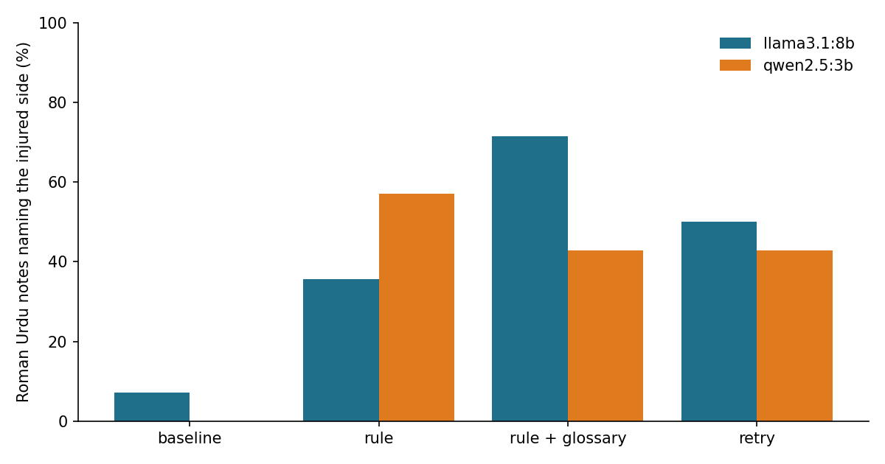

# A side rule for Roman Urdu SOAP notes

**Research question:** In the 20-consultation benchmark, two small local models dropped the injured side ("daayan", "baayan") from almost every Roman Urdu note (llama3.1:8b 13 of 14, qwen2.5:3b 14 of 14). Does a simple side rule bring it back, and does it cost anything: a wrong side, a side that was never said, or other facts lost?

This follows [`roman-urdu-soap-benchmark/`](../roman-urdu-soap-benchmark/) and uses its 20 consultations, note prompt and checks unchanged. Only the Roman Urdu transcripts are drafted.

## Conditions
| Condition | What changes |
|---|---|
| `baseline` | Nothing. The Roman Urdu notes from the benchmark run (same prompt, temperature 0, seed 42), reused, not drafted again. |
| `rule` | One sentence added to the prompt: write the side next to the body part whenever it is said. |
| `rule_glossary` | The rule plus a glossary line: daayan, daayen, dayan = right; baayan, baayen, bayan = left. |
| `retry` | The baseline note is checked. If the Roman Urdu transcript contains a side word and the note names no side, the model is asked once to rewrite the note with the side. If it is still missing, the note is marked incomplete for the physiotherapist. |

The retry check only reads the Roman Urdu transcript, as a real pipeline would. It does not know the right answer. This matters for C4 (neck pain): the transcript says "daayen kandhe tak" (spreading to the right shoulder) but there is no injured side, so the check fires there too.

**Measured:** side named (14 cases with an injured side), wrong side, a side the transcript does not support (all 20 cases), facts missing and critical facts missing (168 and 68 listed), wrong or missing body region, notes retried and still incomplete, and the benchmark safety gate. Each condition is compared with the baseline on the same case with an exact McNemar test on "side named".

## Run
```bash
python3 -m venv .venv && source .venv/bin/activate
pip install -r requirements.txt
python -m pytest -q          # offline tests (fake model)
python side_rule.py          # about 110 model calls, qwen2.5:3b and llama3.1:8b
python side_summary.py       # summary.csv, paired_tests.csv and the chart
```

## Results
_To be filled from my run (`results/summary.csv`, `results/paired_tests.csv`)._

| Model | Condition | Side named (of 14) | Wrong side | Unsupported side (of 20) | Facts missing (of 168) | Critical missing | Retried | Still incomplete | Gate flags (of 20) |
|---|---|---|---|---|---|---|---|---|---|
| qwen2.5:3b | baseline | 0 | 0 | 1 | 50 | 26 | - | 15 | 20 |
| qwen2.5:3b | rule | | | | | | - | | |
| qwen2.5:3b | rule + glossary | | | | | | - | | |
| qwen2.5:3b | retry | | | | | | | | |
| llama3.1:8b | baseline | 1 | 2 | 2 | 16 | 8 | - | 11 | 17 |
| llama3.1:8b | rule | | | | | | - | | |
| llama3.1:8b | rule + glossary | | | | | | - | | |
| llama3.1:8b | retry | | | | | | | | |

Baseline rows are recomputed from the benchmark notes with the same checks. "Still incomplete" counts notes where the transcript has a side word (15 of 20 cases, including C4) but the note names no side.



## My notes
_To be added after reading the notes._

## Limitations
- Same 20 written consultations, one run per model at temperature 0. 14 cases have a side, so a change of a few notes is within chance; the McNemar p-values show this.
- Keyword checks. "Right" can be an ordinary word ("right away"), so a side can be counted as named when it is not.
- The glossary lists only the spellings in my transcripts. Real speakers also say "seedha" and "ulta", and Whisper may spell the words differently.
- New notes are capped at 1024 tokens (`num_predict`); the baseline notes had no cap. qwen2.5:3b kept generating on one note until a 5-minute timeout, three times in a row. Capped notes are kept, marked and counted in `cut_at_cap`.
- A side that is present can still be attached to the wrong body part. Only reading the notes shows this.

## Next steps
- Read every note where the side changed, and label it.
- Run the best condition on Whisper transcripts instead of clean text.
