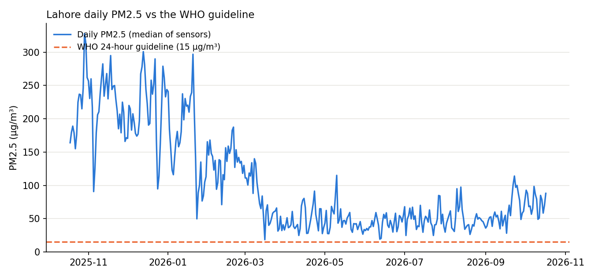
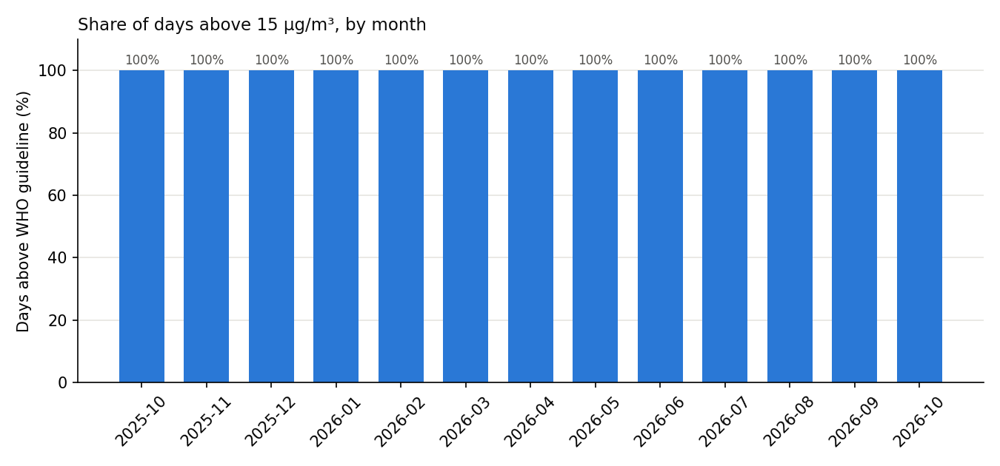

# Lahore PM2.5 vs the WHO guideline

**Research question:** Over the last 12 months, on what share of days did Lahore's daily PM2.5 exceed the WHO 2021 24-hour guideline of 15 µg/m³, and how does that change across the year?

## Why it matters
Lahore's winter smog is a recurring public-health emergency. Headlines usually quote a single bad day; this analysis asks how often the air is unsafe across a whole year, using open monitoring data.

## Data
- **Source:** [OpenAQ](https://openaq.org) v3 API, daily aggregates (`/v3/sensors/{id}/days`) for every fixed PM2.5 sensor within 25 km of central Lahore (31.5204, 74.3587).
- **Guideline:** WHO Global Air Quality Guidelines (2021): PM2.5 24-hour mean 15 µg/m³, annual mean 5 µg/m³. Interim target 1 for 24 hours: 75 µg/m³.
- Raw data is saved to `data/raw_daily_pm25.csv` exactly as downloaded. Data from OpenAQ; the licences of the individual data providers apply.

## Method
1. **Clean:** drop negative values, values above 1000 µg/m³ (sensor errors), days with less than 75% hourly coverage, and duplicate sensor-days.
2. **City value per day:** median across all sensors that reported that day. The median limits the effect of one faulty sensor.
3. **Measure:** share of days above 15 µg/m³ and above 75 µg/m³, the mean against the annual guideline, the worst day, and the same by month.

## Run
```bash
python3 -m venv .venv && source .venv/bin/activate
pip install -r requirements.txt
echo "OPENAQ_API_KEY=your-key" > .env      # free key from explore.openaq.org; .env is git-ignored
python -m pytest -q                        # offline tests
python fetch_openaq.py                     # downloads the last 365 days
python analyze.py                          # writes results/
```

## Key findings
1. **Not one day in the last year met the WHO 24-hour guideline.** 364 of 364 days with data were above 15 µg/m³.
2. **Almost half the year (46%) was above even the weakest WHO interim target** of 75 µg/m³.
3. **The yearly mean (103.8 µg/m³) is about 21 times the WHO annual guideline** of 5 µg/m³.
4. **Winter is extreme, but summer is not clean.** Monthly medians reached about 220 µg/m³ in October to December, while the cleanest months (April to August, 41-49 µg/m³) were still around three times the 24-hour guideline.

## Results
Period: 18 Oct 2025 to 17 Oct 2026 · Days with data: 364 · Sensors found: 84 · Sensors used: 77 (reference monitors: 0) · Rows: 18,660 raw, 15,739 after cleaning

| Measure | Value |
|---|---|
| Days above WHO 24-hour guideline (15 µg/m³) | **100%** (364 of 364) |
| Days above WHO interim target 1 (75 µg/m³) | 46.2% |
| Median daily PM2.5 | 66.7 µg/m³ |
| Mean daily PM2.5 vs WHO annual guideline (5 µg/m³) | 103.8 µg/m³, 20.8 × |
| Worst day | 29 Oct 2025 (328 µg/m³, 21.9 × the 24-hour guideline) |

**By month** (median of daily city values; `results/monthly.csv`):

| Month | Days | Median PM2.5 | Days > 15 | Days > 75 |
|---|---|---|---|---|
| 2025-10 (from 18th) | 14 | 220.0 | 100% | 100% |
| 2025-11 | 29 | 229.0 | 100% | 100% |
| 2025-12 | 31 | 219.0 | 100% | 100% |
| 2026-01 | 31 | 165.5 | 100% | 96.8% |
| 2026-02 | 28 | 137.2 | 100% | 96.4% |
| 2026-03 | 31 | 65.0 | 100% | 38.7% |
| 2026-04 | 30 | 41.0 | 100% | 10.0% |
| 2026-05 | 31 | 43.2 | 100% | 6.5% |
| 2026-06 | 30 | 42.6 | 100% | 0.0% |
| 2026-07 | 31 | 48.9 | 100% | 6.5% |
| 2026-08 | 31 | 46.9 | 100% | 6.5% |
| 2026-09 | 30 | 54.8 | 100% | 23.3% |
| 2026-10 (to 17th) | 17 | 77.5 | 100% | 52.9% |




## My observations
- What surprised me most: across the whole year (364 days), Lahore's air did not fall within the WHO safe limit of 15 µg/m³ on a single day.
- October to December is the worst period. Likely causes are crop-residue burning, winter temperature inversions that trap pollution near the ground, and very still winds. This analysis does not measure these causes; they are hypotheses for the next step.
- Even the cleanest months (April to August) are about three times the WHO limit, so Lahore's pollution is not only a winter problem. It points to a year-round structural problem, likely from transport, industry and dust.
- Because every sensor here is a low-cost sensor, the exact absolute values (especially on humid days) should not be trusted blindly. But the pattern is clear and serious: even in the cleanest month the median (41 µg/m³) is 2.7 times the limit, so the sensors would have to over-read by that much for a typical day to be safe.

## Limitations
- **All 77 sensors used are low-cost sensors; none of the locations used is flagged as a reference-grade monitor in OpenAQ.** Low-cost optical sensors can read high in humid conditions, so absolute values carry real uncertainty.
- Sensors are not evenly spread across the city, and the set of active sensors changes over the year.
- The mean of daily values over this window is only an approximation of an official annual mean.
- Days with no valid sensor are missing, not zero; months with few days are less reliable.

## Next steps
- Compare low-cost sensors with reference monitors on the same days.
- Add weather (humidity, wind, temperature inversions) and crop-burning periods to explain the winter peak.
- Repeat for Karachi, Islamabad and a UK city such as Glasgow as a contrast.
