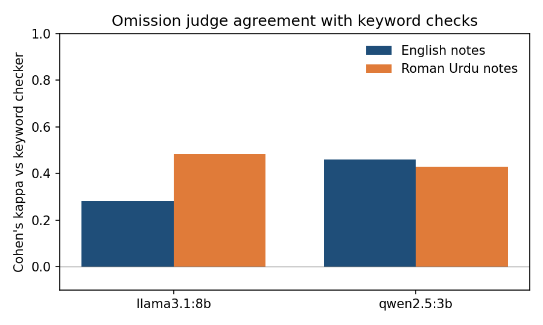

# Can a small local model find what a clinic note left out?

**Research question:** MED-OMIT uses GPT-4 to decide which facts from a consultation are missing from a summary. If `qwen2.5:3b` or `llama3.1:8b` does the same job on my 80 physiotherapy SOAP notes, how well does it agree with the keyword checker, is it worse on notes drafted from Roman Urdu, and does a clinically weighted omission score keep the English vs Roman Urdu gap?

## The paper
Schumacher, E., Rosenthal, D., Nair, V., Price, L., Tso, G. and Kannan, A. *MED-OMIT: Extrinsically-Focused Evaluation of Omissions in Medical Summarization.* arXiv:2311.08303 (2023), [arxiv.org/abs/2311.08303](https://arxiv.org/abs/2311.08303). Later version with D. Naik added: *MED-OMIT: Extrinsically-Focused Evaluation Metric for Omissions in Medical Summarization*, Proceedings of the 4th Machine Learning for Health Symposium, PMLR 259:897-922, 2025, [proceedings.mlr.press/v259/schumacher25a.html](https://proceedings.mlr.press/v259/schumacher25a.html).

What it does: an LLM splits a doctor-patient chat into atomic facts, checks each fact against the summary (missing = left out completely or partly), and weights each omission by how much it matters for a differential diagnosis the LLM also generates (critical 1, important 0.5, other 0.1). The score is a weighted count of omissions. The arXiv version runs the pipeline with GPT-4 on ACI-Bench (English, role-played visits) and summaries from GPT-4 and GPT-3.5-turbo; GPT-4 summaries had fewer omissions (mean count 3.72 vs 5.61). The authors note that ROUGE and BERTScore did not track the number of omissions well for the larger models.

### Gaps I see
1. **The judge is a large hosted model.** A clinic that keeps data on its own machines cannot send notes to GPT-4. Whether a 3B or 8B local model can do the omission step is not shown.
2. **English only, and importance comes from a diagnosis.** No code-mixed or Roman Urdu consultations. In physiotherapy notes the facts that matter most are often the body part, the side and red-flag answers, which a differential diagnosis does not always rank.
3. **Omission only, on a binary scale.** A fact stated wrongly (left knee written as right knee, knee written as hip) is not an omission, so the metric cannot see the errors my benchmark found most often in Roman Urdu notes.

This folder tests gap 1, on the notes from [`roman-urdu-soap-benchmark/`](../roman-urdu-soap-benchmark/).

## Setup
- **Notes:** the 80 notes in `../roman-urdu-soap-benchmark/results/notes.jsonl` (20 fictional cases x English/Roman Urdu x `qwen2.5:3b`/`llama3.1:8b`). No new notes are drafted.
- **Facts:** the 168 listed facts of those cases, 68 critical. I wrote them, so the fact-extraction step of MED-OMIT is replaced by my list.
- **Judges:** `qwen2.5:3b` and `llama3.1:8b` through Ollama, temperature 0, seed 42. One call per note with all of its facts; the reply must be JSON (`present` / `missing` per fact), with one retry if it is not.
- **Comparison:** the keyword checker from the benchmark (`checks.py`). It is not ground truth either, so every disagreement goes into `results/disagreements.csv` for me to label.
- **Weighted score:** MED-OMIT weights with my two tiers: critical fact 1, other fact 0.1.
- Each judge also judges its own notes; that may favour it.

## Run
```bash
python3 -m venv .venv && source .venv/bin/activate
pip install -r requirements.txt
python -m pytest -q     # offline tests (fake model)
python judge.py         # 160 judge calls: 80 notes x 2 judges
python score.py         # agreement.csv, weighted.csv, disagreements.csv, agreement.png
```

## Results
From my run on a MacBook M4 (16 GB), one run at temperature 0.

Judge vs keyword checker (facts across 40 notes per language):

| Judge | Notes from | Parsed | Agreement % | Kappa | Missing (keywords) | Missing (judge) | Judge only | Keywords only |
|---|---|---|---|---|---|---|---|---|
| qwen2.5:3b | English | 336 / 336 | 96.7 | 0.46 | 7 | 14 | 9 | 2 |
| qwen2.5:3b | Roman Urdu | 336 / 336 | 81.2 | 0.43 | 66 | 73 | 35 | 28 |
| llama3.1:8b | English | 336 / 336 | 95.8 | 0.28 | 7 | 13 | 10 | 4 |
| llama3.1:8b | Roman Urdu | 336 / 336 | 83.3 | 0.48 | 66 | 70 | 30 | 26 |

Every reply parsed. Agreement on English notes looks high only because almost nothing is missing (7 of 336 facts by keywords), so a checker that always said "present" would also agree about 98% of the time; kappa removes that. On Roman Urdu notes both judges flagged about as many facts as the keywords, but largely different ones. Critical facts the judge called missing and the keywords did not: llama3.1:8b 5 (English) and 9 (Roman Urdu), qwen2.5:3b 1 and 8.

Mean weighted omissions per note (critical 1, other 0.1):

| Note model | Language | Keywords | qwen2.5:3b judge | llama3.1:8b judge |
|---|---|---|---|---|
| qwen2.5:3b | English | 0.03 | 0.10 | 0.12 |
| qwen2.5:3b | Roman Urdu | 1.42 | 0.96 | 0.75 |
| llama3.1:8b | English | 0.01 | 0.02 | 0.17 |
| llama3.1:8b | Roman Urdu | 0.44 | 0.35 | 0.58 |

All three scorers put Roman Urdu notes well above English ones, but by how much depends on the scorer: for qwen2.5:3b notes the gap is 1.39 with keywords and 0.63 with the llama3.1:8b judge.



## My notes
I read 10 of the 144 disagreements against the notes (the 5 critical English facts where the llama3.1:8b judge said missing and the keywords present, and the first 5 Roman Urdu rows).
- **The judge caught missing urgency.** For the possible DVT (C14) both notes say the patient should go to hospital, but neither says today or urgent. The keywords passed the fact "hospital today"; the judge called it missing, and for a suspected clot that part matters. The same happened with the X-ray in C8. But the judge also called "Inform GP about potential tendon effect of ciprofloxacin" missing in C17, which is plainly in the note.
- **A contradiction passed as present.** In C2 the patient said the knee swelled up; the qwen2.5:3b note from Roman Urdu says "There is no swelling in the area". The keyword check found "swell" and passed it; the qwen2.5:3b judge called it missing. It is really a contradiction, not an omission, and neither method has a label for that (gap G12).
- **The worst judge error hid two red flags.** The qwen2.5:3b note for C1 (Roman Urdu) never mentions numbness or urine, both critical red-flag answers, yet the qwen2.5:3b judge marked both present. A judge that does this would hide the very facts it is meant to protect, so a small local judge cannot replace the keyword check; at most it is a second opinion.
- Of the 10 rows, the judge was right in 5, the keywords in 4, and one (C16, "urgent GP referral today" written as "urgent referral to GP") is borderline. Ten rows of 144 is too few to say which checker is better.

## Limitations
- 80 notes from 20 consultations I wrote; one run.
- Neither the judge nor the keywords are ground truth; my labels on the disagreements are the check.
- All facts of a note go in one call, unlike MED-OMIT's one fact per call.
- No differential-diagnosis weighting; only my critical / other tiers.
- Judges see the note and the fact list, not the transcript, so they cannot catch added facts.
- I labelled only 10 of the 144 disagreements.

## Article
[A small local AI checked clinic notes for missing facts. It caught lost urgency, and passed two missing red flags](https://masmatixinnovations.co.uk/insights/llm-omission-judge.html)

## Next steps
- Label all 144 disagreements and a sample of rows where both checkers agree.
- Add a third label, "contradicted", to the judge prompt (G12).
- Ask about one fact per call, as MED-OMIT does, and compare.
