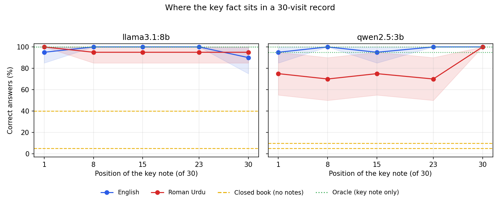

# Lost in the middle of a patient record

Follow-up to Liu et al., *Lost in the Middle: How Language Models Use Long Contexts*
([arXiv:2307.03172](https://arxiv.org/abs/2307.03172), published in TACL). The paper found that large
models answer best when the useful document is at the start or end of the prompt, and worst when it
is in the middle. Their tests used English Wikipedia questions and models of 7B parameters and up.

**Research question.** When one safety fact (an allergy, a pacemaker, a blood thinner) sits somewhere in
a 30-visit physiotherapy record, does a small local model (qwen2.5:3b, llama3.1:8b) find it equally well
at every position, and is it worse when the record is in Roman Urdu?

## Design
- **20 facts**, each with a question and accepted answer words (`records.py`). Examples: rash after
  diclofenac, pacemaker, warfarin, saddle numbness, 34 weeks pregnant, steroid injection.
- **Records.** 30 routine visit notes per fact. Exactly one note (the key note) holds the fact; the other
  29 are built from fixed sentence pools and are identical for every position, so only the order changes.
  The Roman Urdu record is a line-by-line translation of the English one. All notes are invented.
- **Conditions** per fact, language and model:
  - `closed_book`: the question only, to see how guessable each answer is
  - `oracle`: the key note only
  - key note at visit 1, 8, 15, 23 or 30 of 30
- **Models:** qwen2.5:3b and llama3.1:8b through Ollama, temperature 0, seed 42, context 8192 tokens,
  48 answer tokens. The prompt token count is saved for every call, so a prompt cut by the context limit
  would be visible (`possibly_cut`).
- **Scoring:** correct if an accepted answer word appears in the reply (the paper's metric).
  Tests check that the answer word appears only in the key note and never in the question.
- **Size:** 20 facts x 7 conditions x 2 languages x 2 models = 560 answers.

## Files
| File | What it does |
|---|---|
| `records.py` | facts, sentence pools, builds each record with the key note at a chosen position |
| `score.py` | answer-word matching |
| `run.py` | resumable runner, writes `results/runs.jsonl` and skips finished answers |
| `analysis.py` | accuracy per position with bootstrap 95% intervals over facts, best minus worst position, exact McNemar tests, `results/results.json`, `results/summary.csv`, `results/position_curve.png` |
| `tests/test_bench.py` | offline tests, including a full mock run with a scripted model |

## Run
```bash
python3 -m venv .venv && source .venv/bin/activate
pip install -r requirements.txt
python -m pytest -q
caffeinate -i python run.py      # Ollama must be running
python analysis.py
```

## Results
One run on my MacBook M4 (16 GB), Ollama, temperature 0, seed 42, 560 answers. No prompt was cut by the context limit.

| Model | Language | Closed book | Oracle | Note 1 | Note 8 | Note 15 | Note 23 | Note 30 | Best - worst |
|---|---|---|---|---|---|---|---|---|---|
| llama3.1:8b | English | 8/20 | 20/20 | 19/20 | 20/20 | 20/20 | 20/20 | 18/20 | 10 pts |
| llama3.1:8b | Roman Urdu | 1/20 | 20/20 | 20/20 | 19/20 | 19/20 | 19/20 | 19/20 | 5 pts |
| qwen2.5:3b | English | 2/20 | 19/20 | 19/20 | 20/20 | 19/20 | 20/20 | 20/20 | 5 pts |
| qwen2.5:3b | Roman Urdu | 1/20 | 20/20 | 15/20 | 14/20 | 15/20 | 14/20 | 20/20 | 30 pts |



- **No U-shape.** llama3.1:8b found the fact at every position in both languages (18 to 20 of 20), and so did qwen2.5:3b in English. No first-versus-middle test was significant.
- **qwen2.5:3b in Roman Urdu was right 20 of 20 times only when the fact was in the last note**, and 14 or 15 of 20 at notes 1 to 23. With the key note alone (oracle) it was 20 of 20, so it can read the note; it loses the fact in the long Roman Urdu record. Against note 30, note 1 gives p = 0.06 and note 8 p = 0.03 (exact McNemar, 20 facts).
- **English against Roman Urdu, qwen2.5:3b:** 6 facts right only in English at notes 8 and 23 (p = 0.03 each), 5 against 1 at notes 1 and 15 (p = 0.22), none at note 30. After Holm correction for the five positions none is below 0.05.
- **Closed book:** llama3.1:8b answered 8 of 20 English questions with no notes at all (F02 pacemaker, F03 warfarin, F08 insulin, F10 ankle, F13 epilepsy, F14 hearing aid, F15 breast, F19 L4), so these questions can be guessed from the question alone.
- **The 22 qwen2.5:3b Roman Urdu misses were not random.** F03 (warfarin) and F11 (stairs) failed at 4 of 5 positions, F10 and F17 at 3. In 9 misses the reply was a routine sentence, or part of one, copied from another visit. For F03 it answered that the patient takes no medicine ("No dawa nahi batai gayi", "No dawa leta hai") at every position except the last.
- **Scoring check:** at F18 note 23 qwen2.5:3b replied in Chinese, naming Lahore (拉合尔) but the wrong date (23 March instead of 3 March). The keyword scorer counted it wrong; read by hand, qwen2.5:3b Roman Urdu at note 23 is 15 of 20.

## My notes
1. qwen2.5:3b on 30-visit Roman Urdu records did not show the U-shape reported on English Wikipedia. It looked like recency: 20/20 only when the fact was in the last visit, 14 to 15/20 at all earlier positions. With 20 facts this is not yet significant at every position.
2. The failures were systematic. F03 (warfarin) and F11 (stairs) failed at 4 of 5 positions, often because the model copied a routine sentence from another visit, such as "Subah taqreeban ek ghanta kamar akri rehti hai".
3. The most dangerous failure was F03: the model answered "No dawa nahi batai gayi" or "No dawa leta hai" at four positions, which turns a patient on warfarin into a patient on no medicine.
4. qwen2.5:3b also made up words ("Kafreen ka bimarani") and once answered in Chinese, naming Lahore correctly but with the wrong date; the keyword scorer missed that one.
5. llama3.1:8b guessed 8 of 20 English answers with no notes (pacemaker, warfarin, insulin and others), which is a limit of this benchmark. qwen2.5:3b still missed warfarin when the record was in Roman Urdu.

Article: [A small local AI lost facts anywhere but the last visit of a Roman Urdu record](https://masmatixinnovations.co.uk/insights/lost-in-the-middle-clinic-records.html)

## Limitations
- 20 facts, so one fact is 5 percentage points; intervals will be wide.
- The records are synthetic and repetitive; real notes vary more in length, wording and abbreviations.
- About 1,500 to 2,500 prompt tokens, shorter than the paper's 20 and 30 document settings.
- Keyword scoring can count a reply as correct if it lists several guesses, and can miss a correct
  paraphrase; replies are saved so they can be read.
- One run at temperature 0; one prompt wording.
- Several questions can be guessed without notes (8 of 20 for llama3.1:8b in English), which lifts its English scores.
- Each position was tested separately; with 20 facts, differences of 5 or 6 facts are at the edge of significance.

## Reference
Nelson F. Liu, Kevin Lin, John Hewitt, Ashwin Paranjape, Michele Bevilacqua, Fabio Petroni, Percy Liang.
Lost in the Middle: How Language Models Use Long Contexts. arXiv:2307.03172, 2023.
https://arxiv.org/abs/2307.03172
