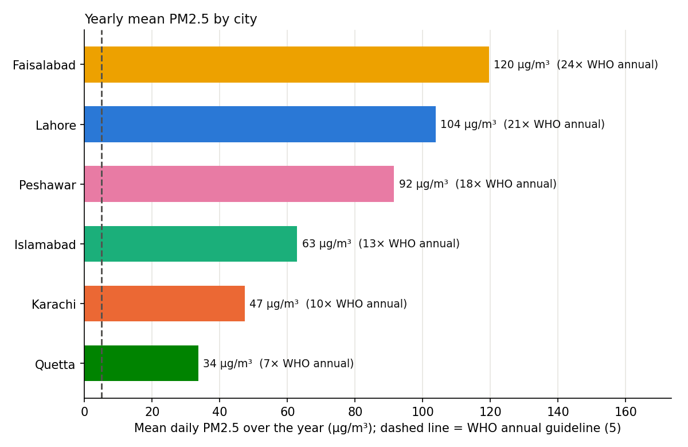
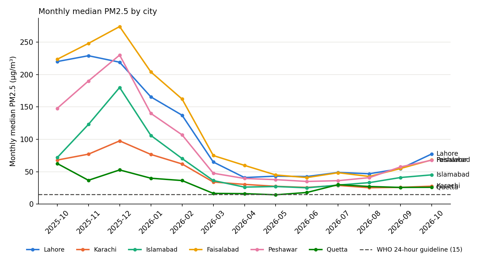

# Six Pakistani cities, one year of air

**Research question:** Over the same 12 months, how do Lahore, Karachi, Islamabad, Faisalabad, Peshawar and Quetta compare on daily PM2.5 against the WHO 2021 guideline, and which cities have too little open monitoring data to say?

## Why it matters
National headlines focus on Lahore's winter smog. This compares the main cities on the same rules and the same time window, and treats missing data as a finding: a city that is not measured cannot be protected.

## Data
- **Source:** [OpenAQ](https://openaq.org) v3 API, daily PM2.5 aggregates for every fixed sensor within 25 km of each city centre. Same 365-day window for all cities.
- **Guideline:** WHO Global Air Quality Guidelines (2021): PM2.5 24-hour mean 15 µg/m³, defined as the 99th percentile of the year (about 3-4 days above it are allowed), and annual mean 5 µg/m³. Interim target 1 (24-hour): 75 µg/m³.
- Raw data is saved per city in `data/`. Data from OpenAQ; the licences of the individual data providers apply.

## Method
1. **Clean** each city the same way: drop negative values, values above 1000 µg/m³, days with less than 75% hourly coverage, and duplicate sensor-days.
2. **City value per day:** median across that city's sensors.
3. **Inclusion rule:** a city enters the comparison only with at least **3 sensors** and **300 days** of valid data. Others are reported as "insufficient data".
4. **Compare:** yearly mean (and × WHO annual guideline), share of days above 15 and 75 µg/m³, days at or below 15, worst and cleanest day, and monthly medians.

Note: Islamabad's 25 km circle also covers much of Rawalpindi.

## Run
```bash
python3 -m venv .venv && source .venv/bin/activate
pip install -r requirements.txt
python -m pytest -q
python fetch_cities.py        # uses OPENAQ_API_KEY from .env or ../lahore-smog/.env
python analyze_cities.py      # writes results/
```

## Key findings
1. **No city met the WHO 24-hour guideline**, which allows only 3-4 days above 15 µg/m³ a year. Even the cleanest city, Quetta, was above it on 307 of 364 days (84%).
2. **Faisalabad was worse than Lahore**: yearly mean 119.6 µg/m³ (24 × the WHO annual guideline), no clean day at all, and the single worst day in the study (407 µg/m³ on 14 Jan 2026, 27 × the 24-hour guideline).
3. **Peshawar ranked third** (91.5 µg/m³, 18 ×), ahead of Islamabad and Karachi, despite getting far less public attention than Lahore.
4. **Monitoring is very uneven.** All six cities had data on 364 days, but a typical day had 46 sensors in Lahore and only 7 in Quetta and 9 in Peshawar. Only one of 223 sensors used is a reference-grade monitor (in Islamabad).
5. **Reproducible:** Lahore's numbers match the separate [`lahore-smog/`](../lahore-smog/) run exactly (mean 103.8, 46.2% of days above 75).

## Data availability
Window: 18 Oct 2025 to 18 Oct 2026, 25 km around each city centre.

| City | Sensors found | Sensors used | Reference monitors | Days with data | Sensors on a typical day | Included |
|---|---|---|---|---|---|---|
| Lahore | 83 | 77 | 0 | 364 | 46 | yes |
| Karachi | 42 | 37 | 0 | 364 | 14 | yes |
| Islamabad | 37 | 35 | 1 | 364 | 18 | yes |
| Faisalabad | 40 | 36 | 0 | 364 | 20 | yes |
| Peshawar | 22 | 22 | 0 | 364 | 9 | yes |
| Quetta | 19 | 16 | 0 | 364 | 7 | yes |

## Results
Ranked by yearly mean (mean of daily city values).

| City | Yearly mean (µg/m³) | × WHO annual (5) | Days > 15 | Days ≤ 15 | Days > 75 | Worst day | Cleanest day |
|---|---|---|---|---|---|---|---|
| Faisalabad | 119.6 | 23.9 | 100% | 0 | 48.4% | 14 Jan 2026 (407.0) | 12 Jun 2026 (18.7) |
| Lahore | 103.8 | 20.8 | 100% | 0 | 46.2% | 29 Oct 2025 (328.0) | 16 Mar 2026 (18.4) |
| Peshawar | 91.5 | 18.3 | 99.7% | 1 | 39.8% | 20 Dec 2025 (387.5) | 21 May 2026 (14.4) |
| Islamabad | 62.9 | 12.6 | 98.9% | 4 | 26.6% | 19 Dec 2025 (226.0) | 21 Jul 2026 (7.9) |
| Karachi | 47.4 | 9.5 | 98.9% | 4 | 19.5% | 20 Dec 2025 (150.0) | 29 Mar 2026 (7.7) |
| Quetta | 33.6 | 6.7 | 84.3% | 57 | 5.8% | 16 Nov 2025 (134.0) | 29 May 2026 (2.3) |




## My observations
- What surprised me most: Faisalabad came out more polluted than Lahore, with the worst single day in the study (407 µg/m³), and Peshawar quietly ranked third even though the media mostly ignores it.
- Faisalabad and Lahore may be the worst because they are Punjab's dense industrial and population hubs: heavy industry, textile mills, heavy traffic, and the Indo-Gangetic plain's geography together with crop-residue burning. These causes are hypotheses; this analysis does not measure them.
- Karachi may do better because sea breezes keep flushing pollution out, and Quetta because of its high altitude and lower industrial density compared with the plains. Also hypotheses to test with wind and land-use data.
- With fewer sensors in the smaller cities, their numbers can be more volatile, and a few local pockets can bias the whole-city picture. Their trends should not be treated as final absolute truth until the network is denser.

## Limitations
- Almost all OpenAQ sensors in Pakistan are low-cost sensors, which can read high in humid conditions. Humidity differs a lot between cities (for example coastal Karachi and dry Quetta), so the bias may differ by city.
- Sensor counts differ between cities; a city with few sensors is less certain even when it passes the inclusion rule.
- A fixed 25 km circle is a simple definition of a city and covers different shares of each urban area.
- The mean of daily values over this window approximates, but is not, an official annual mean.

## Next steps
- Apply a humidity correction to low-cost sensors and check whether the ranking changes.
- Add wind, temperature and satellite fire counts to explain the differences.
- Build a small agent that answers air-quality questions for these cities, in English and Roman Urdu, using this data as a tool.
