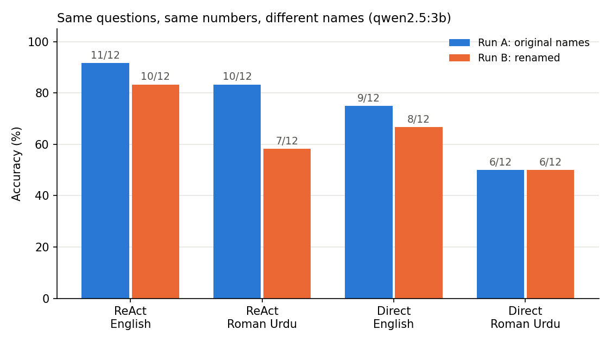

# ReAct on Roman Urdu with a small local model

**Research question:** Does a small local LLM (≈3B, Ollama on a MacBook M4) keep its ReAct tool-use accuracy when the same clinic questions are asked in Roman Urdu instead of English, and how stable is that result?

## Paper
Yao, S., Zhao, J., Yu, D., Du, N., Shafran, I., Narasimhan, K., Cao, Y. (2022). *ReAct: Synergizing Reasoning and Acting in Language Models.* ICLR 2023. [arXiv:2210.03629](https://arxiv.org/abs/2210.03629)

ReAct makes an LLM alternate **Thought → Action → Observation**. Main experiments used prompted PaLM-540B (plus GPT-3) on four English benchmarks (HotpotQA, FEVER, ALFWorld, WebShop).

## Gap tested here
The paper's benchmarks are all English, and its prompted results come from very large models. This experiment checks prompted ReAct with a **~3B local model** on **Roman Urdu** (code-mixed, Latin-script Urdu), which is how many Pakistani patients and clinicians actually type.

## Setup
- **Data:** a *fictional* physiotherapy clinic (`clinic_kb.json`: 6 patients, 3 therapists). It is fictional so the model cannot answer from memory and must use tools. No real patient data.
- **Questions:** 12 questions (1–3 hops) in `questions.json`, each with an English and a Roman Urdu version and the same gold answer.
- **Tools:** `lookup_patient`, `lookup_therapist`, `calculate` (AST-based, no `eval`).
- **Methods:**
  - `ReAct`: one English few-shot example, model generates Thought/Action, the code runs the tools and injects real Observations (generation stops at `Observation:` so the model can't invent them).
  - `Direct (KB in prompt)`: the whole database in the prompt, one call, no tools.
- **Decoding:** temperature 0, seed 42.
- **Metrics:** accuracy, average steps, share of runs with ≥1 format (parse) error, share hitting the step limit, median latency.

## Two runs
- **Run A (original names):** first run. Results kept in `results/run-a-original-names/`.
- **Run B (renamed):** the same 12 questions, the same numbers and the same gold answers; only the patient and therapist names were changed (in the database, the questions and the prompt example). Results in `results/qwen2.5_3b/`.

The pair works as a small robustness check: if the agent really reasons over the tool outputs, surface names should not matter.

## Run
```bash
python -m venv .venv && source .venv/bin/activate
pip install -r requirements.txt
ollama pull qwen2.5:3b
python -m pytest -q                      # offline tests, no model needed
python run_experiment.py --model qwen2.5:3b
python compare_runs.py                   # Run A vs Run B chart
```
Outputs go to `results/<model>/`: `results.csv`, `summary.csv`, `trajectories.jsonl` (full Thought/Action traces), `accuracy_chart.png`.

## Key findings
1. **ReAct beat the direct baseline in every condition** (both runs, both languages), mostly because it hands arithmetic to a calculator.
2. **The Roman Urdu result is not stable.** Changing only the names moved ReAct on Roman Urdu from 83% to 58% (-25 points); English moved by one question.
3. **Roman Urdu failures were language-understanding errors, not tool errors:** "5 saal baad" (in 5 years) was computed as a subtraction, and "mila kar" (combined) as a difference.
4. **The agent can still hallucinate inside the loop:** it skipped a lookup and invented a therapist's specialty.

## Results
Model: `qwen2.5:3b` (local, Ollama) · Machine: MacBook M4, 16 GB · temperature 0, seed 42 · 12 questions per language

| Method | Language | Run A (original names) | Run B (renamed) | Change |
|---|---|---|---|---|
| ReAct | English | 11/12 (91.7%) | 10/12 (83.3%) | -1 question |
| ReAct | Roman Urdu | 10/12 (83.3%) | 7/12 (58.3%) | **-3 questions** |
| Direct (KB in prompt) | English | 9/12 (75.0%) | 8/12 (66.7%) | -1 question |
| Direct (KB in prompt) | Roman Urdu | 6/12 (50.0%) | 6/12 (50.0%) | 0 |



Run B details: ReAct averaged 3.8 steps (English) and 3.7 steps (Roman Urdu), with no format errors and no step-limit hits. Median latency was 3.1 s (English) and 2.9 s (Roman Urdu) for ReAct versus 0.16 s for the direct baseline, so the accuracy gain costs roughly 20× latency.

## Error analysis (Run B, from `trajectories.jsonl`)
| Question | Language | What happened | Type |
|---|---|---|---|
| Q09 "Mudassar Munier 5 saal baad kitne saal ke honge?" | Roman Urdu | Looked up age 38, then `calculate[38 - 5]` → answered 33 | Misread "baad" (after) as before |
| Q12 "Dr. Urooj aur Dr. Robina ka mila kar kitne saal ka tajurba hai?" | Roman Urdu | Looked up both (6 and 8), then `calculate[6 - 8]` → "2 years more" | Misread "mila kar" (combined) as a difference |
| Q03 "Khadija Khan ka therapist kaun hai aur unki specialty kya hai?" | Roman Urdu | Read the patient record only, never called `lookup_therapist`, answered "Orthopedics" | Hallucination (specialty is not in the data) |
| Q03 | English | Stopped at "Dr. Urooj" without the specialty | Stopped one hop early |
| Q04 | English | Sent the patient's name to `lookup_therapist`, got "not found", answered "No information available" | Wrong tool input, no recovery (same failure in both runs) |
| Q08, Q10 | Roman Urdu | Wrong final value ("4 sessions", "0") | Reasoning error |

In both ReAct examples above the tools worked correctly; the model chose the wrong operation because it misunderstood the Roman Urdu wording.

## My observations
- In Q04 the agent used the wrong tool and then gave up instead of trying another route. It happened in both runs, so it is a stable weakness, not chance.
- "No information available" is the safer kind of failure in a clinic: a confident wrong number could harm a patient. But Q03 shows the same agent can also invent an answer, so abstention cannot be relied on.
- Roman Urdu answers still came back mostly in English. My hypothesis: the model's training data is mostly English, so it reasons in English and loses meaning in words like "baad" and "mila kar". The English few-shot example may also push it that way (not yet tested).
- The name swap changed Roman Urdu accuracy by 25 points. With 12 questions, a single run cannot support strong claims; I need more questions and several variations per question.
- Around 3 s per question is slow for a live conversation, but can be acceptable for drafting notes after a consultation.

## Limitations
- Only 12 questions × 2 languages: one question = 8.3 percentage points. No confidence intervals yet.
- One model, one seed, temperature 0. Run B also changed the names in the prompt example, not only in the data.
- Roman Urdu questions were written by one person; real users spell Roman Urdu in many ways ("baqi / baki", "kitne / kitnay").
- Scoring is lenient (any matching number in the answer counts) and will not credit numbers written as words ("chhe").
- The prompt example is in English for both conditions, so this measures "English prompt + Roman Urdu question", not a fully Roman Urdu agent.
- Tiny fictional database: the direct baseline is unrealistically easy because everything fits in the prompt.

## Next steps
- Build 50+ questions with several name sets and spelling variants per question, and report mean and spread instead of a single run.
- Add Roman Urdu terms for time and arithmetic ("baad", "pehle", "mila kar", "farq") as a targeted test set.
- Compare 2-3 local models (e.g. `llama3.2:3b`, `qwen2.5:7b`) and a Roman Urdu prompt example.
- Test a simple guard: require a tool observation for every fact in the final answer (targets the Q03 hallucination).
