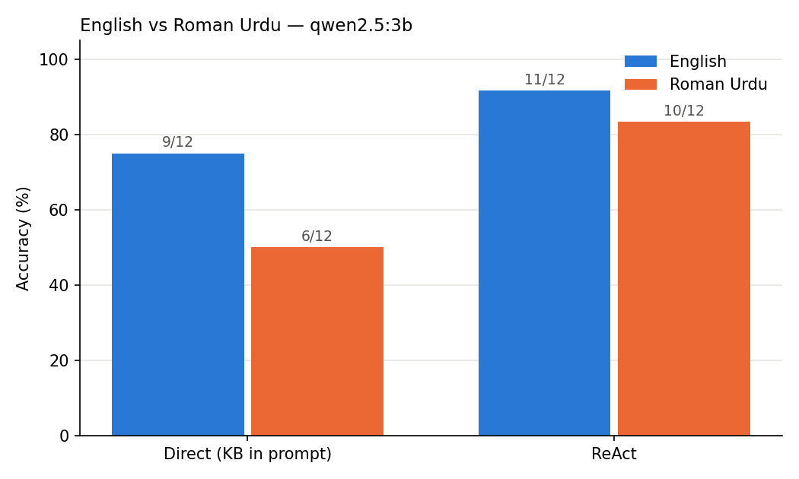

# ReAct on Roman Urdu with a small local model

**Research question:** Does a small local LLM (≈3B, Ollama on a MacBook M4) keep its ReAct tool-use accuracy when the same clinic questions are asked in Roman Urdu instead of English?

## Paper
Yao, S., Zhao, J., Yu, D., Du, N., Shafran, I., Narasimhan, K., Cao, Y. (2022). *ReAct: Synergizing Reasoning and Acting in Language Models.* ICLR 2023. [arXiv:2210.03629](https://arxiv.org/abs/2210.03629)

ReAct makes an LLM alternate **Thought → Action → Observation**. Main experiments used prompted PaLM-540B (plus GPT-3) on four English benchmarks (HotpotQA, FEVER, ALFWorld, WebShop).

## Gap tested here
The paper's benchmarks are all English, and its prompted results come from very large models. This experiment checks prompted ReAct with a **~3B local model** on **Roman Urdu** (code-mixed, Latin-script Urdu), which is how many Pakistani patients and clinicians actually type.

## Setup
- **Data:** a *fictional* physiotherapy clinic (`clinic_kb.json`: 6 patients, 3 therapists). It is fictional so the model cannot answer from memory and must use tools. No real patient data.
- **Questions:** 12 questions (1–3 hops) in `questions.json`, each with an English and a Roman Urdu version and the same gold answer.
- **Tools:** `lookup_patient`, `lookup_therapist`, `calculate` (AST-based, no `eval`).
- **Methods:**
  - `ReAct`: one English few-shot example, model generates Thought/Action, the code runs the tools and injects real Observations (generation stops at `Observation:` so the model can't invent them).
  - `Direct (KB in prompt)`: the whole database in the prompt, one call, no tools.
- **Decoding:** temperature 0, seed 42.
- **Metrics:** accuracy, average steps, share of runs with ≥1 format (parse) error, share hitting the step limit, median latency.

## Run
```bash
python -m venv .venv && source .venv/bin/activate
pip install -r requirements.txt
ollama pull qwen2.5:3b
python -m pytest -q                      # offline tests, no model needed
python run_experiment.py --model qwen2.5:3b
```
Outputs go to `results/<model>/`: `results.csv`, `summary.csv`, `trajectories.jsonl` (full Thought/Action traces), `accuracy_chart.png`.

## Results
Model: `qwen2.5:3b` (local, Ollama) · Machine: MacBook M4, 16 GB · Date: 2026-10-18 · temperature 0, seed 42

| Method | Language | Correct | Accuracy | Avg steps | Parse-error rate | Median latency (s) |
|---|---|---|---|---|---|---|
| ReAct | English | 11/12 | 91.7% | 4.08 | 0.0 | 3.58 |
| ReAct | Roman Urdu | 10/12 | 83.3% | 3.83 | 0.0 | 3.35 |
| Direct (KB in prompt) | English | 9/12 | 75.0% | 1.00 | 0.0 | 0.16 |
| Direct (KB in prompt) | Roman Urdu | 6/12 | 50.0% | 1.00 | 0.0 | 0.15 |

**What the numbers show (pilot, n = 12 per cell):**
- ReAct scored higher than the direct baseline in both languages (+2 questions in English, +4 in Roman Urdu).
- Switching to Roman Urdu cost the direct baseline 3 questions (75% → 50%) but ReAct only 1 (92% → 83%). With 12 questions, a 1-question gap is within noise.
- Most direct-baseline failures were arithmetic (e.g. q07, q10, q11); ReAct offloads arithmetic to the `calculate` tool.
- ReAct was ~20× slower per question (≈3.5 s vs ≈0.16 s): the accuracy gain costs latency.
- ReAct failures: q04 English ("No information available"), q05 Roman Urdu (stopped at "Dr. Omar", one hop short), q10 Roman Urdu (answered 3 instead of 3.5).
- The model answered Roman Urdu questions mostly in English despite being told to reply in the question's language.



## My observations
- **q04 (English, ReAct):** the model sent the *patient's* name to `lookup_therapist` instead of first calling `lookup_patient` to find the therapist. After the "not found" observation it did not try another route; it stopped and answered "No information available". The same question in Roman Urdu was answered correctly (11 years), so the planning step is not stable.
- **Abstaining was the safe failure:** in a clinic, "no information" is much safer than a confident wrong number, because wrong medical data can harm a patient. Still, the ideal agent would recover and find the right answer.
- **Language of the answer:** Roman Urdu questions were mostly answered in English. My hypothesis: the model's training data is mostly English, so it switches to English while reasoning. The English few-shot example in the prompt may also push it that way (not yet tested).
- **Latency:** ~3.5 s per question is slow for a live conversation in a clinic, where a pause that long feels awkward, but it can be acceptable for accuracy, e.g. when drafting notes after the consultation.

## Limitations
- Only 12 questions × 2 languages: one question = 8.3 percentage points, so small differences are noise. No confidence intervals yet.
- Single model, single seed, temperature 0.
- Roman Urdu questions were written by one person; real users spell Roman Urdu in many ways ("baqi / baki", "kitne / kitnay").
- Scoring is lenient (any matching number in the answer counts) and will not credit numbers written as words ("chhe").
- The few-shot example is in English for both conditions, so this measures "English prompt + Roman Urdu question", not a fully Roman Urdu agent.
- Tiny fictional database: the direct baseline is unrealistically easy because everything fits in the prompt.

## Next steps
- Add spelling variants and Urdu-script versions of each question; grow to 50+ questions.
- Compare 2–3 local models (e.g. `llama3.2:3b`, `qwen2.5:7b`) and a Roman Urdu few-shot example.
- Categorise failures the way the paper does (reasoning error, bad tool input, hallucination, format error).
