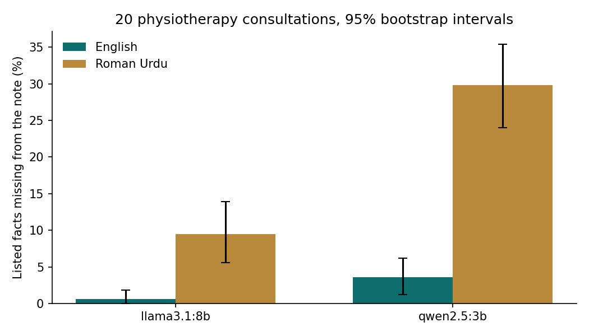

# Roman Urdu vs English SOAP notes: a 20-consultation benchmark

**Research question:** Across 20 physiotherapy consultations, do two small local models (`qwen2.5:3b`, `llama3.1:8b`) leave out more facts, more critical facts and name the wrong body part or side more often when the consultation is in Roman Urdu instead of English? And how many notes would a simple safety gate send to a clinician?

This extends [`clinical-note-hallucination/`](../clinical-note-hallucination/) (4 consultations) and [`translate-then-draft/`](../translate-then-draft/). Both pilots found wrong body parts and lost red-flag answers in Roman Urdu notes, but 4 cases are too few to tell a real difference from chance.

## Setup
- **Cases:** the 4 pilot consultations plus 16 new fictional ones I wrote (`data/consultations.json`), 20 in total, each in English and Roman Urdu with the same facts and numbers. Body regions: back, neck, shoulder, knee, hip and pelvis, ankle and foot, wrist and hand, elbow. Clinical terms that clinicians in Pakistan say in English (ligament, ACL, scaphoid, carpal tunnel) are kept in English inside the Roman Urdu, as in real code-mixed speech. No real patient data.
- **Red flags on purpose:** saddle numbness and urine problems (cauda equina, C11), calf swelling after knee replacement (possible DVT, C14), weight loss with past cancer (C16), possible scaphoid fracture on warfarin (C8). A note that drops these is unsafe.
- **Facts:** 168 listed facts, 68 marked critical (red-flag answers, medicines, referrals, urgent actions).
- **Models:** `qwen2.5:3b` and `llama3.1:8b` through Ollama, temperature 0, seed 42, same note prompt as the pilots.
- **Checks (`checks.py`):** missing facts (keyword patterns), main body region present, body regions not in the transcript, injured side named, other side named without support. The **safety gate** sends a note for clinician review if any of these fail or a critical fact is missing.
- **Statistics (`summarise.py`):** facts-missing rate with a 95% bootstrap interval over cases, and an exact McNemar test on the same fact in English vs Roman Urdu for each model.

## Run
```bash
python3 -m venv .venv && source .venv/bin/activate
pip install -r requirements.txt
python -m pytest -q        # offline tests (fake model)
python run.py              # 80 notes: 20 cases x 2 languages x 2 models
python summarise.py        # summary.csv, paired_tests.csv and the chart
```

## Results
From my run on a MacBook M4 (16 GB), one run at temperature 0.

| Model | Language | Facts missing | % (95% CI) | Critical missing | Wrong or missing region | Side missing / wrong | Gate flags (of 20) |
|---|---|---|---|---|---|---|---|
| qwen2.5:3b | English | 6 / 168 | 3.6 (1.2–6.2) | 0 | 3 | 0 / 0 | 3 |
| qwen2.5:3b | Roman Urdu | 50 / 168 | 29.8 (24.0–35.4) | 26 | 11 | 14 / 0 | 20 |
| llama3.1:8b | English | 1 / 168 | 0.6 (0.0–1.8) | 0 | 0 | 0 / 0 | 0 |
| llama3.1:8b | Roman Urdu | 16 / 168 | 9.5 (5.6–13.9) | 8 | 6 | 13 / 2 | 17 |

Side columns are out of the 14 cases with an injured side. Mean time per note: qwen2.5:3b 5.2 s (English) and 6.4 s (Roman Urdu), llama3.1:8b 11.6 s and 14.6 s.

Paired test, English vs Roman Urdu (same 168 facts, exact McNemar):

| Model | Facts | Missing only in Roman Urdu | Missing only in English | p |
|---|---|---|---|---|
| qwen2.5:3b | all | 47 | 3 | < 0.0001 |
| qwen2.5:3b | critical (68) | 26 | 0 | < 0.0001 |
| llama3.1:8b | all | 16 | 1 | 0.0003 |
| llama3.1:8b | critical (68) | 8 | 0 | 0.0078 |



**Main finding:** with both models, the same facts were lost far more often from Roman Urdu consultations than from English ones, and the difference holds for critical facts alone. llama3.1:8b lost 8 critical facts from Roman Urdu and none from English; qwen2.5:3b lost 26 and none.

**Errors found by reading the notes** ([`results/notes.jsonl`](results/notes.jsonl)):
- **C14, llama3.1:8b:** "left knee replacement" became "**hip** replacement" and the swollen calf was not mentioned. The note still raised a possible DVT and sent the patient to hospital, but without the calf sign and with the wrong joint.
- **C6, llama3.1:8b:** left hip osteoarthritis became "osteoarthritis of the **lower back**". qwen2.5:3b made the same hip into a **knee**.
- **C2, llama3.1:8b:** the twisted knee became an **ankle**, the same error as in the pilot.
- **C3 and C8, llama3.1:8b:** the left shoulder and the left hand became the **right**.
- **C11, qwen2.5:3b (cauda equina):** saddle numbness was lost, and the note added "difficulty in defecation" and "a 45-year-old male", neither of which was said. It did keep the emergency.
- **C20, llama3.1:8b:** the note added a headache that was never mentioned.
- **The side was almost never written** from Roman Urdu: missing in 13 of 14 llama3.1:8b notes and 14 of 14 qwen2.5:3b notes. "Daayan" and "baayan" were dropped rather than translated.

**What the gate flagged:** all 17 flagged llama3.1:8b Roman Urdu notes failed at least one check; 5 of them only for the missing side. Of the 3 qwen2.5:3b English flags, the C14 one is real (the knee replacement is not mentioned), and the C5 and C12 ones are not body-part errors: "calf exercises" for an ankle sprain and "right leg" for a right knee injury.

## My notes
- The most dangerous error was C14 from llama3.1:8b: the left knee replacement became a hip replacement and the swollen calf disappeared. After knee surgery a swollen calf is the main warning sign of a DVT, and a missed clot can travel to the lungs. The note still said DVT and hospital, but a physiotherapist reading it would examine the wrong joint and could not see why a clot was suspected.
- The side was dropped from almost every Roman Urdu note. A model cannot be trusted to keep it, so the pipeline should check it: if the transcript says daayan, baayan, left or right, the note must state the side; if not, ask the model once more, and if it is still missing mark the note incomplete for the physiotherapist. This is a proposal and needs its own test.
- The gate sent 17 of 20 llama3.1:8b Roman Urdu notes for review. That is a lot, but every flagged note failed a real check, 5 of them only for the missing side. I have not read all 17 by hand, and the 3 notes that passed were not checked either, so how many errors the gate misses is still unknown.
- For MeetPhysio, correcting a flagged draft should still be quicker than writing the note from scratch, but I have not measured this.

## Article
[In 20 clinic consultations, local AI lost red flags and the injured side when patients spoke Roman Urdu](https://masmatixinnovations.co.uk/insights/roman-urdu-soap-benchmark.html)

## Limitations
- 20 consultations I wrote, one run per model at temperature 0. Larger than the pilots but still small, and written rather than recorded speech.
- Checks are keyword based. A fact written in unexpected words counts as missing; a fact stated wrongly can count as present. "Right" can also appear as an ordinary word ("right away").
- The region check also flags fair wording (2 of 3 qwen2.5:3b English flags).
- The gate shows which notes need a person; it is not a measure of how many notes are wrong. That needs every sentence labelled.
- I wrote the Roman Urdu myself; spelling varies between speakers.

## Next steps
- Label every sentence of the flagged notes, and the unflagged ones, to measure what the gate misses.
- Test the side rule: reject a note without a side when the transcript has one, and retry once.
- Feed Whisper transcripts instead of clean text.
