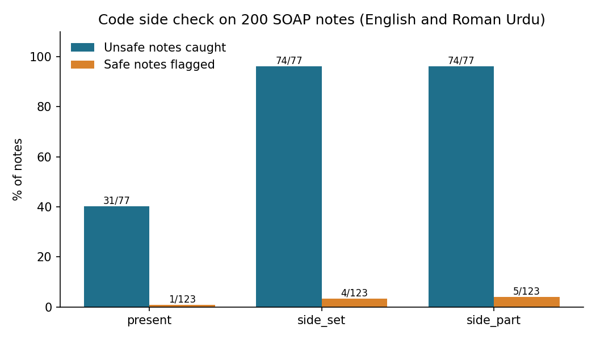

# Code side check for SOAP notes

**Research question:** The side rule test ([`injured-side-rule/`](../injured-side-rule/)) showed that telling a small local model to write the injured side made it write the wrong side more often. If code, not the model, compares the side words in the transcript with the side words in the note, how many unsafe notes does it catch, and how many safe notes does it send for review by mistake?

No model is called. The check runs on the 200 notes already drafted in earlier runs:

| Notes | From | Count |
|---|---|---|
| English, baseline | [`roman-urdu-soap-benchmark/`](../roman-urdu-soap-benchmark/) | 2 models x 20 cases = 40 |
| Roman Urdu, baseline, rule, rule + glossary, retry | [`injured-side-rule/`](../injured-side-rule/) | 2 models x 4 conditions x 20 cases = 160 |

## The three checks
Each check reads only what a real pipeline sees: the transcript in the language spoken, and the note. Side words are read in English and Roman Urdu spellings (daayan, daayen = right; baayan, baayen = left).

| Check | Sends the note for review when |
|---|---|
| `present` | the transcript has a side word and the note has none (the check used by the retry condition) |
| `side_set` | as above, or the note names a side the transcript never says |
| `side_part` | as above, or the note puts a side on a body part where the transcript puts the other side on the same limb (for example "left shoulder" when only "daayen kandhe" was said) |

**Reference label:** a note is unsafe on side if the injured side is missing, the other side is named, or a side is named that the English transcript does not contain. This uses the benchmark checks, the English transcript and the known injured side, so it is not the same information the checks see. It reads only English words in the note, so it can be wrong; [`results/to_label.csv`](results/to_label.csv) lists every note where `side_part` and the reference disagree, plus a fixed random sample, for me to label by hand.

## Run
```bash
python3 -m venv .venv && source .venv/bin/activate
pip install -r requirements.txt
python -m pytest -q                  # 10 offline tests
python side_check.py                 # a few seconds; writes results/
# after filling my_label (safe or unsafe) in results/to_label.csv:
python side_check.py --score-labels
```

## Results
From my run on a MacBook M4 (16 GB). The checks are deterministic, so a rerun gives the same numbers. The reference marked 77 of the 200 notes unsafe on side (all Roman Urdu); a note naming only the other side counts as both wrong and missing, so those two columns overlap.

| Check | Notes flagged (of 200) | Unsafe caught (of 77) | Wrong or unsupported side caught (of 43) | Missing side caught (of 69) | Safe notes flagged (of 123) |
|---|---|---|---|---|---|
| `present` | 32 | 31 | 0 | 31 | 1 |
| `side_set` | 78 | 74 | 43 | 66 | 4 |
| `side_part` | 79 | 74 | 43 | 66 | 5 |

No English note was unsafe on side. `side_part` flagged one English note (C4), where "neck mobility to the left" was followed by "Arm strength": a movement direction, not a side.



**Hand labels.** I labelled 20 notes ([`results/to_label.csv`](results/to_label.csv)): all 8 notes where `side_part` and the reference disagree, plus 12 at random. I judged the whole note as safe or unsafe for a physiotherapist, not only the side. 8 were safe and 12 unsafe. The sample is picked to contain hard cases, so it does not give an accuracy for all 200 notes.

| Check | Agrees with me (of 20) | My unsafe notes caught (of 12) | My safe notes flagged (of 8) |
|---|---|---|---|
| Reference (English words only) | 14 | 6 | 0 |
| `present` | 11 | 3 | 0 |
| `side_set` | 15 | 7 | 0 |
| `side_part` | 14 | 7 | 1 |

**Main finding:** comparing sides, not asking for one, is what matters. The check used by the retry condition before (`present`) caught none of the 43 notes with a wrong or unsupported side; comparing the side words in the transcript with the note (`side_set`) caught all 43 and flagged 4 of 123 safe notes. Linking the side to a body part (`side_part`) added nothing on these notes and added one false flag.

The five unsafe notes in my labels that `side_set` passed all had the side right or absent but something else wrong:
- **C6, llama3.1:8b, rule:** "lower back pain (baayan koolha)": the left hip became the lower back, with the side only in copied Roman Urdu.
- **C10 and C19, llama3.1:8b, rule:** the side is only inside copied Roman Urdu text, for example "the leg (daayen taang mein pair tak dard jata hai)".
- **C5, qwen2.5:3b, retry:** a right ankle sprain became a "right knee" LCL sprain.
- **C4, qwen2.5:3b, rule + glossary:** the neck pain was replaced by right hand and shoulder pain.

## My notes
- A side that appears only inside copied Roman Urdu, like "lower back pain (baayan koolha)" in C6 or the full sentence in brackets in C19, is unsafe to me. A physiotherapist who does not read Roman Urdu cannot use it. The side check counts these words as a side and passes the note.
- In C15, C16 and C20 the glossary made llama3.1:8b add a side to consultations that have none ("daayan pelvis", "daayan kamar"). The side check flagged all three, but the automatic reference missed them because it reads only English words. Here the check was right and the reference was wrong.
- The side check cannot see a wrong body part. C5 turned a right ankle into a right knee and C4 replaced neck pain with hand and shoulder pain; both passed every side check.
- For MeetPhysio I would use `side_set` as the side gate, add a body-part check built the same way (transcript vs note), and send any note with untranslated Roman Urdu to review. `side_part` is not worth it on these notes.

## Article
[Checking the injured side with code, not the AI, caught all 43 wrong sides in Roman Urdu notes](https://masmatixinnovations.co.uk/insights/side-mismatch-check-roman-urdu.html)

## Limitations
- Same 20 written consultations and the notes of one run per model. The check is not tested on new notes or on Whisper transcripts, where side words may be spelled differently.
- Keyword reading. "Right" can mean "correct" and "left" can be a verb; "to the left" can be a movement direction, not the injured side.
- The Roman Urdu side and body-part word lists cover the spellings in my transcripts and a few variants. "Seedha" and "ulta" are not read.
- A side is attached to the body part in the next 4 words only. Longer sentences are missed.
- The reference label is automatic and reads only English words in the note; it missed three invented sides. My hand labels cover 20 of the 200 notes, chosen to include hard cases, and are one person's judgement.

## Next steps
- A body-part check built the same way: body words in the transcript (ghutna, takhna, kandha, gardan) compared with the note.
- A check that sends any note with untranslated Roman Urdu text to review.
- Run `side_set` on Whisper transcripts and on new consultations, and measure the review workload.
