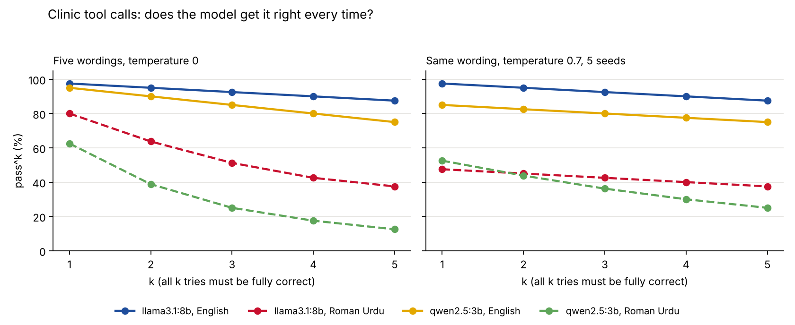

# Tool-call consistency (pass^k) with small local models

**Research question:** When a small local model makes the same clinic tool call five times, how often is it fully correct every time, in English and in Roman Urdu, and is the variation caused by the wording of the request or by random sampling?

## Why it matters
A clinic agent that books the right appointment four times out of five is not safe to leave alone. Most tool-use scores report one try per task (pass^1). The tau-bench paper (Yao et al. 2024) introduced **pass^k**: the chance that *all* k tries of the same task succeed. For GPT-4o on its retail tasks, pass^1 was about 61% and pass^8 fell below 25%. The paper did not test small 7/13B models, used English only, and its repeated tries differ both in the simulated user's wording and in sampling. This folder measures pass^k for two small local models on Roman Urdu and English clinic tool calls, and separates the two sources of variation.

## Design
- **Tasks:** the 8 clinic tool calls from [`../tool-call-self-correction/`](../tool-call-self-correction/) (appointments, vitals, pain score, reminders, refund, cancellation, patient search, exercise log), same schemas, same ground truth, same system prompt and the same validator code.
- **Two conditions, 5 tries each:**
  - *Wording:* the original request plus 4 new wordings with the same meaning ([`data/variants.json`](data/variants.json)), temperature 0, seed 42. Roman Urdu wordings use the spelling variety people really type (kr/kar, dopehar/dopahar, nai/nahi).
  - *Sampling:* the original wording, temperature 0.7, seeds 1 to 5.
- **Models:** `qwen2.5:3b` and `llama3.1:8b` through Ollama, at most 256 output tokens per call. A call that times out (120 s) is retried once; if it times out again it is recorded as a failed call.
- **Grid:** 2 models x 8 tasks x 2 languages x 2 conditions x 5 tries = 320 calls.
- **Pass:** schema valid and every value correct (no retries; the earlier folder found all first tries were schema valid).
- **Metric:** pass^k = mean over tasks of C(c, k) / C(n, k), with n = 5 tries and c passes (the tau-bench estimator), for k = 1 to 5. 95% bootstrap intervals resample the 8 tasks (2,000 resamples, seed 42). Also counted: tasks that always, sometimes or never pass, and the number of distinct JSON outputs per task.

## Run
```bash
python3 -m venv .venv && source .venv/bin/activate
pip install -r requirements.txt
python -m pytest -q            # offline tests with a scripted fake model
caffeinate -i python run.py    # needs Ollama with qwen2.5:3b and llama3.1:8b; resumable
python analysis.py             # writes results/summary.csv, task_outcomes.csv, results.json, pass_k.png
```
`run.py` appends one line per call to `results/runs.jsonl` and skips finished calls, so it can be stopped and restarted.

## Results
320 calls on a MacBook M4, all completed (no timeouts in the final run). 95% intervals resample the 8 tasks.

| Model | Language | Condition | pass^1 | pass^5 [95% CI] | Tasks always / sometimes / never right | Distinct outputs per task |
|---|---|---|---|---|---|---|
| llama3.1:8b | English | wording | 97.5% | 87.5% [62.5, 100] | 7 / 1 / 0 | 1.12 |
| llama3.1:8b | English | sampling | 97.5% | 87.5% [62.5, 100] | 7 / 1 / 0 | 1.12 |
| llama3.1:8b | Roman Urdu | wording | 80.0% | 37.5% [0, 75.0] | 3 / 5 / 0 | 1.88 |
| llama3.1:8b | Roman Urdu | sampling | 47.5% | 37.5% [12.5, 75.0] | 3 / 1 / 4 | 1.62 |
| qwen2.5:3b | English | wording | 95.0% | 75.0% [37.5, 100] | 6 / 2 / 0 | 1.25 |
| qwen2.5:3b | English | sampling | 85.0% | 75.0% [37.5, 100] | 6 / 1 / 1 | 1.12 |
| qwen2.5:3b | Roman Urdu | wording | 62.5% | 12.5% [0, 37.5] | 1 / 7 / 0 | 2.50 |
| qwen2.5:3b | Roman Urdu | sampling | 52.5% | 25.0% [0, 62.5] | 2 / 3 / 3 | 1.62 |



**What I found**

- **English calls were mostly repeatable.** pass^5 was 87.5% for llama3.1:8b and 75% for qwen2.5:3b in both conditions.
- **Roman Urdu calls were not.** pass^5 fell to 12.5-37.5%. One try hides this: with five wordings, qwen2.5:3b got 62.5% of single tries right but only 12.5% of tasks right all five times; llama3.1:8b went from 80% to 37.5%.
- **The two sources of variation fail differently in Roman Urdu.** Rewording made most tasks *sometimes* right (5 of 8 tasks for llama3.1:8b, 7 of 8 for qwen2.5:3b). Sampling the original wording made failures *systematic*: llama3.1:8b got 4 of 8 Roman Urdu tasks wrong in all five samples (time, pulse, amount and reason), so a retry with a new seed would not have fixed them.
- **The fields that broke** were the ones that need interpretation rather than copying: the appointment time (T01), pulse (T02), pain score (T03), refund amount (T05), cancellation reason (T06) and city (T07), and once the reminder interval (T04). The exercise log (T08) was right in every try for both models and languages.
- 150 of 320 replies wrapped the JSON in code fences despite the instruction not to; it could still be parsed. 6 replies were not schema valid.

Eight tasks give wide intervals, so the English-versus-Roman-Urdu gap is clear but the differences between models and conditions are not.

## Limitations
- 8 tasks only, so the bootstrap intervals are wide; this is a pilot for a larger task set.
- The 4 extra wordings per request were written by me; they are not a sample of real clinic staff messages.
- Ollama seeds make runs repeatable on one machine, but outputs can differ across Ollama versions and hardware.
- One-turn tool calls only. tau-bench scores full multi-turn conversations with a simulated user; this test isolates the single call.
- Exact-match scoring after light normalisation; a free-text field written in a different but acceptable way counts as wrong.

## Reference
- Yao, S., Shinn, N., Razavi, P. and Narasimhan, K. (2024). *tau-bench: A Benchmark for Tool-Agent-User Interaction in Real-World Domains*. [arXiv:2406.12045](https://arxiv.org/abs/2406.12045).
