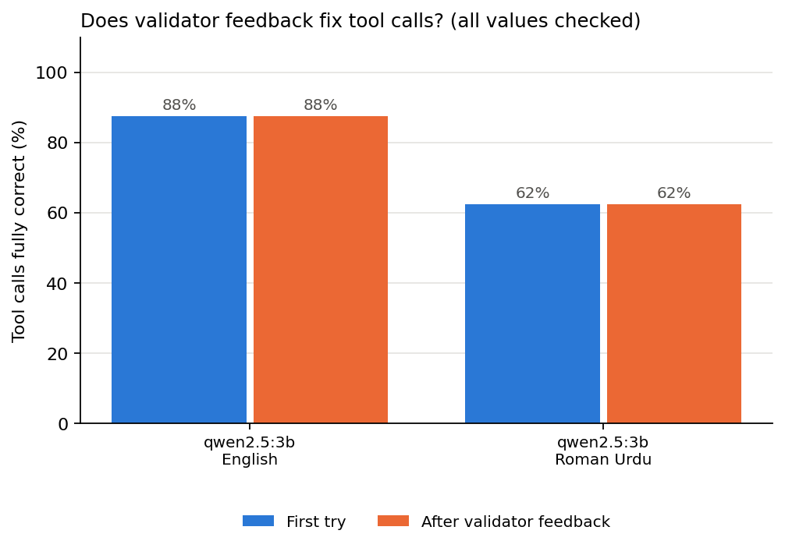

# Tool-call self-correction with a small local model

**Research question:** When a ~3B local model makes a tool call (JSON) for a clinic system, how often is it fully correct on the first try, and does feedback from a schema validator fix the errors, in English and in Roman Urdu?

## Why it matters
An agent acts through tool calls: book an appointment, record vitals, refund a payment. A common safety net is a validator that rejects malformed calls and asks the model to try again. That net can only catch what a schema can see (missing keys, wrong types, bad formats). A call that is valid JSON with the wrong time or the wrong patient passes straight through. This experiment measures both kinds of error separately.

## Setup
- **Model:** `qwen2.5:3b` through Ollama (`/api/chat`, temperature 0, seed 42). Other models can be added with `--models`.
- **Tasks:** 8 clinic tool calls (`data/tasks.json`), each asked once in English and once in Roman Urdu, so 16 calls per model. Requests include numbers in words ("seventy-two", "bahattar"), times in words ("half past two", "dopahar dhai baje"), enums and booleans.
- **Loop:** attempt 1 is the baseline. If the validator finds schema issues, the issues and the previous reply are sent back, up to 2 retries. The feedback never contains the expected values.
- **Two scores per call:**
  - *Schema valid:* what a validator can check (keys, types, `YYYY-MM-DD`, `HH:MM`, enums, ranges, bare JSON with no code fences).
  - *Fully correct:* every value matches the ground truth (case and punctuation ignored).

## Run
```bash
python3 -m venv .venv && source .venv/bin/activate
pip install -r requirements.txt
python -m pytest -q        # offline tests for the validator
python run.py              # needs Ollama running with qwen2.5:3b
python summarise.py        # writes results/summary.csv and results/self_correction.png
```

## Results
From my run on a MacBook M4 (16 GB), `qwen2.5:3b`, one run at temperature 0. Counts are out of 8 tasks per language.

| Model | Language | Schema valid, first try | Schema valid, after feedback | Fully correct, first try | Fully correct, after feedback | Valid but wrong value |
|---|---|---|---|---|---|---|
| qwen2.5:3b | English | 8 / 8 | 8 / 8 | 7 / 8 | 7 / 8 | 1 |
| qwen2.5:3b | Roman Urdu | 8 / 8 | 8 / 8 | 5 / 8 | 5 / 8 | 3 |



**Main finding:** every one of the 16 calls passed the schema validator on the first try, so the self-correction loop never ran. Yet 4 calls (25%) carried a wrong value, 3 of them in Roman Urdu. In this pilot, all of the errors were the kind a schema validator cannot see.

The four wrong calls (from [`results/attempts.jsonl`](results/attempts.jsonl)):

| Task | Language | Request said | Model wrote |
|---|---|---|---|
| T01 book_appointment | Roman Urdu | "dopahar dhai baje" (14:30) | `"time": "14:00"` |
| T05 refund_payment | English | "forty-five pounds fifty" (45.50) | `"amount": 45` |
| T05 refund_payment | Roman Urdu | "paintalees pound pachaas pence" (45.50) | `"amount": 100` |
| T07 search_patients | Roman Urdu | "Glasgow mein" | `"city": ""` |

- **Invented value:** in the Roman Urdu refund, 100 appears nowhere in the request. The model did not misread a number; it produced a new one.
- **Fractions get dropped:** "dhai" (two and a half) became 2 o'clock, and "fifty" pence was lost in English too, so this is not only a Roman Urdu problem.
- **An empty string is still a string:** the missing city passed the validator because the schema only asked for a string.
- Output format was not the problem: all 16 replies were bare JSON with no code fences.

Summary table: [`results/summary.csv`](results/summary.csv).

## My notes
- The most dangerous error was T05 in Roman Urdu, where the model wrote a refund of 100 that was never asked for. A wrong refund is a billing error; if the same failure happened in a tool that records a medication dose, it could harm a patient.
- My guess is that number words like "dhai" and "paintalees" are rare in the model's training data, so it handles them less reliably than digits. I have not tested this yet; English also lost the 50 pence, so fractions may be hard in both languages.
- I would add two safety steps on top of the validator: stricter schema rules (no empty strings, allowed ranges for numbers) and a confirmation step that reads the call back to the user before it runs, for example "Refund £45.50 for INV-1029, is that right?". The schema rules would catch the empty city; only the confirmation step would catch the invented 100.

## Earlier pilot
`results/pilot_2_tasks.json` is a first pilot with 2 English tasks (`qwen2.5:3b` and `llama3.1:8b`). All 4 calls passed on the first attempt, so the retry loop was never used, and that checker only looked at key names and types, not values. The tasks here were made harder so that the loop is actually exercised, and values are checked against the truth.

## Limitations
- 8 tasks per language is a pilot. A difference of one task is 12.5 percentage points, so small gaps mean little.
- Temperature 0 gives one deterministic answer per task; it does not show how stable the model is under sampling.
- The tasks and Roman Urdu wording were written by me; other spellings of Roman Urdu could give different results.
- The value check is an exact match after normalising case and punctuation, so a correct paraphrase of a free-text field would count as wrong.
- Because no call failed the schema, this run says nothing about how well feedback fixes errors when it does run. It only shows that, here, the errors were not schema errors.

## Next steps
- Grow to 50+ tasks with several Roman Urdu spellings, and run 5 seeds at a non-zero temperature.
- Compare with `llama3.1:8b` and with Ollama's JSON mode (`format: json`).
- Tighten the schema (no empty strings, sensible number ranges) and re-run to see which errors it now catches.
- Test a confirmation step ("read the call back to the user") for errors that the schema cannot catch.
- Test number words directly: the same requests with digits ("2:30", "45.50") vs words ("dhai", "paintalees"), to check whether the words cause the errors.
