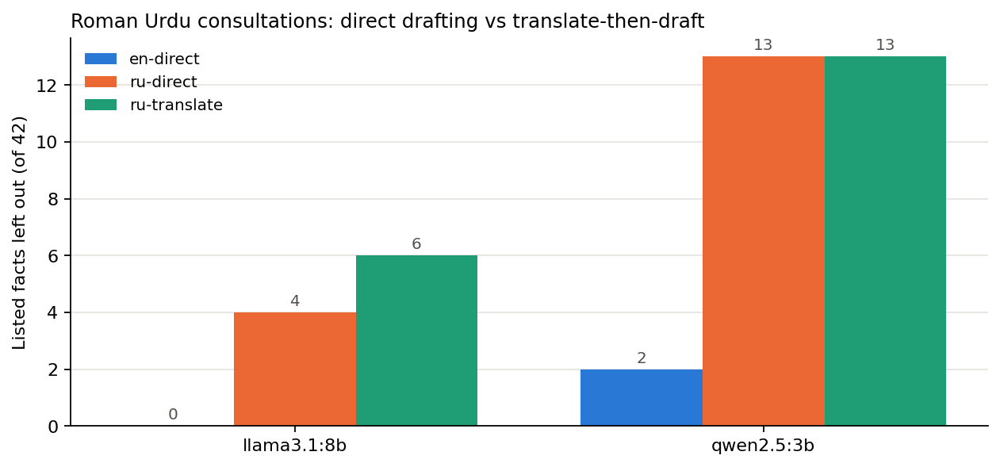

# Translate first, or draft directly? Roman Urdu SOAP notes from small local models

**Research question:** For Roman Urdu physiotherapy consultations, does translating the transcript into English first and then drafting the SOAP note keep more key facts and the right body part than drafting directly, and does a larger local model (`llama3.1:8b`) change the answer?

This follows [`clinical-note-hallucination/`](../clinical-note-hallucination/), where `qwen2.5:3b` left out 13 of 42 listed facts in Roman Urdu notes (2 of 42 in English) and wrote about the wrong body part in 3 of 4 Roman Urdu notes. There I suggested translate-then-draft as a fix, with the risk that the translation step makes the same mistakes. This experiment measures it.

## Setup
- **Models:** `qwen2.5:3b` and `llama3.1:8b` through Ollama (temperature 0, seed 42).
- **Data:** the same 4 fictional consultations and fact lists as `clinical-note-hallucination/data/consultations.json` (reused, not copied). No real patient data.
- **Conditions** per model and consultation:
  - `en-direct`: English transcript to note (reference)
  - `ru-direct`: Roman Urdu transcript to note
  - `ru-translate`: the same model translates the Roman Urdu transcript into English, then drafts the note from its own translation
- **Note prompt:** identical to the earlier experiment, so the numbers are comparable.
- **Omissions:** the same keyword patterns per listed fact. For `ru-translate`, the patterns are also run on the translation, to see whether a fact was lost in translation or in drafting.
- **Body region check (new, `body_checks.py`):** a note must name the consultation's main region (back, knee, shoulder, neck) and should not name a region that never appears in the English transcript. Run on the 8 earlier `qwen2.5:3b` notes, it flags exactly the 3 Roman Urdu notes with a wrong body part (C1 knee, C2 groin, C4) and none of the English notes.

## Run
```bash
python3 -m venv .venv && source .venv/bin/activate
pip install -r requirements.txt
python -m pytest -q        # offline tests (no model needed)
python run.py              # 24 notes + 8 translations, both models
python summarise.py        # results/summary.csv and the chart
```

## Results
From my run on a MacBook M4 (16 GB), one run per condition at temperature 0. 4 notes per condition, 42 listed facts.

| Model | Condition | Facts missing (of 42) | Critical missing | Main region missing (of 4) | Notes naming other regions | Mean seconds |
|---|---|---|---|---|---|---|
| qwen2.5:3b | en-direct | 2 | 0 | 0 | 0 | 6.2 |
| qwen2.5:3b | ru-direct | 13 | 7 | 3 | 3 | 6.8 |
| qwen2.5:3b | ru-translate | 13* | 7* | 3* | 3* | 12.8 |
| llama3.1:8b | en-direct | 0 | 0 | 0 | 0 | 11.2 |
| llama3.1:8b | ru-direct | 4 | 3 | 1 | 1 | 13.4 |
| llama3.1:8b | ru-translate | 6 | 5 | 0 | 1 | 24.8 |

\* **qwen2.5:3b did not translate.** In all 4 cases its "translation" is the Roman Urdu transcript unchanged, so the note it drafted is identical to the `ru-direct` note. Translate-then-draft was not really tested for this model.



**Main finding:** with `llama3.1:8b`, translating first did not help. Critical facts missing rose from 3 to 5, and the translation step added its own errors (from `results/notes.jsonl`):
- **C3:** "kandha" (shoulder) became "**lower back**" in the translation, and the note said "lower back pain for 4 months".
- **C4:** reduced turning of the neck to the **left** ("baayen") became "**right**"; "daayen kandhe" (right shoulder) became "shoulders".
- **C2:** "swelled up" became "**I slept on it**"; "does not lock" became "it's not giving way", right after "it gave way 2 times"; the right side was lost.
- **C1:** "no numbness" became a second "no problem with urination", so the numbness answer was lost.

Translation fixed one error: drafting directly, `llama3.1:8b` wrote "**ankle**" for the twisted knee in C2; from its translation the note said knee.

**The larger model helped more than the pipeline.** Drafting directly from Roman Urdu, `llama3.1:8b` missed 4 of 42 facts against 13 for `qwen2.5:3b`, and named the wrong body part in 1 note against 3.

**Checker note:** `llama3.1:8b` translated "chakkar" as "vertigo", a fair translation, but the keyword check counts "no dizziness" as missing. The body-region check flagged every body-part error I found by reading the notes.

Files: [`results/notes.jsonl`](results/notes.jsonl) (notes and translations), [`results/omissions.csv`](results/omissions.csv), [`results/body_regions.csv`](results/body_regions.csv), [`results/summary.csv`](results/summary.csv).

## My notes
- The most dangerous errors were the changes of side and body part that `llama3.1:8b` made while translating: in C4 the neck's left side became the right, and in C3 the shoulder became the lower back. A note like this would lead to treatment and exercises for the wrong area, so it has to be caught before anyone acts on it.
- `qwen2.5:3b` skipped the translation step and returned the Roman Urdu input unchanged, and the pipeline carried on as if it had worked. A pipeline should check every step, for example stop when the translation is the same as (or almost the same as) the input, and pass the case to a person.
- For MeetPhysio, the safer route from this data is direct drafting with the 8B model plus a required physiotherapist review before sign-off. Translate-then-draft raised critical missing facts from 3 to 5 and swapped side and anatomy. Direct 8B missed 4 of 42 facts against 13 for the 3B model, but it still wrote "ankle" for a knee, so it cannot be used without review.
- "Vertigo" for "dizziness" is a fair translation; my keyword check counted it as missing. That is a limit of the checker, not a model error.

## Article
[Translating Roman Urdu first did not make a local AI's clinic notes safer](https://masmatixinnovations.co.uk/insights/translate-then-draft-roman-urdu.html)

## Limitations
- 4 consultations, one run per condition at temperature 0. A pilot, not a benchmark.
- Omission and body-region checks are keyword based. A fact written in unexpected words counts as missing; a fact stated wrongly can still count as present. The body-region check catches a wrong region only if that region's word appears in the note.
- The fact patterns were written for notes, so "missing in translation" can over-count (for example a translation that says "about 6" without "out of 10").
- Sentence-level hallucination labels are not repeated here; this run measures omissions and body-region errors only.
- Transcripts are clean text, not speech-to-text output.
- The translation prompt was the same for both models; a different prompt might get `qwen2.5:3b` to translate.

## Next steps
- Add a step check (translation equal to input, or missing body part) that stops the pipeline.
- Label every sentence of the direct `llama3.1:8b` notes.
- Feed Whisper transcripts instead of clean text.
