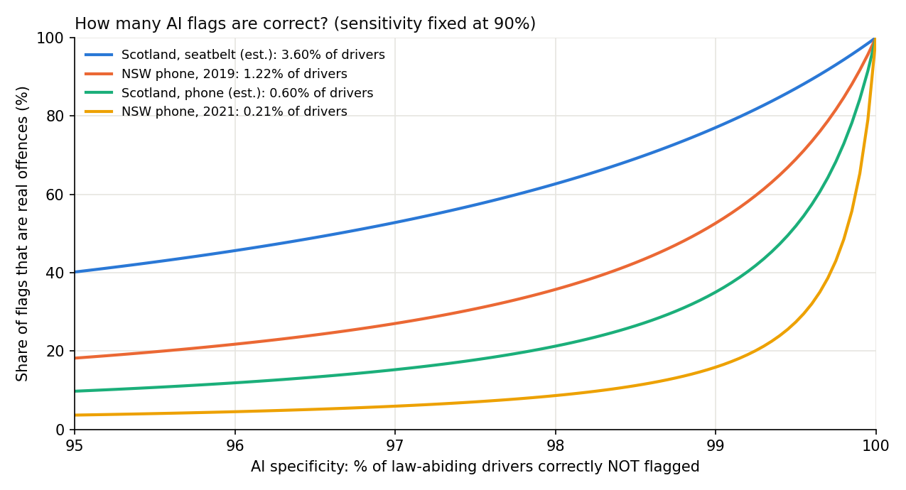
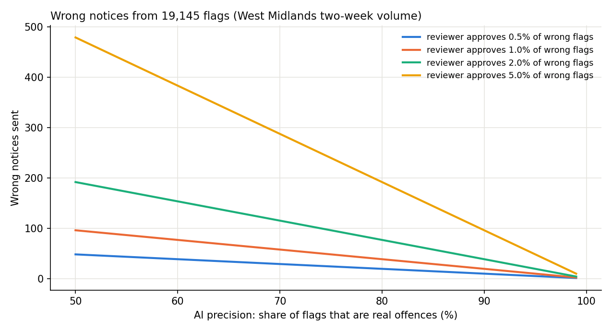

# AI road-safety cameras: how many flags are wrong?

**Research question:** UK trials of AI cameras that detect drivers using a phone or not wearing a seatbelt report how many offences the AI *flagged*. Using published offence-rate estimates, how many of those flags could be wrong, and how much does human review matter?

## Why it matters
AI cameras from Acusensus are now used by several UK police forces. Sussex Police switched them on in April 2026, with officers checking each flagged image before any action. A two-week trial in the West Midlands produced 19,145 flags. Headlines often call these "offences", but a flag is only a candidate. In Athens, leaked figures suggest only 400 of 5,500 reviewed AI citations were judged valid, with errors such as empty seats flagged for no seatbelt and dark shirts read as missing belts.

The question is not whether the AI is "good" but what happens at scale: a small error rate on a very large number of law-abiding drivers can still produce many wrong flags.

## Public figures used
All in [`data/public_figures.csv`](data/public_figures.csv), each with its source and date.

| Trial | Figure | Value | Note |
|---|---|---|---|
| West Midlands, 2 weeks (March) | Seatbelt flags | 17,225 | Initial AI scans, not enforced |
| West Midlands | Phone flags | 1,920 | Initial AI scans |
| West Midlands | Images checked by operators | 8,024 | Accuracy result not published |
| Sussex, 7 days (2024) | Offences detected | 458 | National Highways trial |
| Athens, Apr-May 2026 | AI citations | ~13,000 | Leaked figures |
| Athens | Reviewed by staff | 5,500 | Leaked |
| Athens | Judged valid | 400 | Leaked |
| Athens | Rejected: phone/seatbelt and similar misreads | 1,300 | Leaked |
| Scotland (2026 pilot announcement) | Daily vehicle journeys | 4.7 million | Government estimate |
| Scotland | Drivers not wearing a seatbelt, per day | ~169,000 | Government estimate, about 3.6% |
| Scotland | Drivers using a handheld phone, per day | ~28,000 | Government estimate, about 0.6% |
| New South Wales | Phone-use detection rate | 1 in 82 drivers (2019), 1 in 478 (2021) | After cameras were introduced |

UK penalties for context: handheld phone use carries 6 penalty points and a £200 fixed penalty (up to £1,000 if it goes to court); not wearing a seatbelt can bring a fine of up to £500.

Scotland, where I live, started its own pilot of the same Acusensus system in 2026 (two trailer-mounted cameras rotating across 12 locations, with a two-stage human review), so this question is about to matter here too.

## Method
1. **Precision model.** For a camera with sensitivity *s* (share of real offences it flags) and specificity *t* (share of law-abiding drivers it correctly leaves alone), when a share *q* of drivers actually offend, the share of flags that are real is

   precision = s·q / (s·q + (1 − t)·(1 − q))

   Prevalence comes from public estimates: Scotland's seatbelt (3.6%) and phone (0.6%) figures, and the New South Wales phone detection rates before and after cameras (1.2% in 2019, 0.2% in 2021). Sensitivity is fixed at 90% and specificity is varied; **those two are assumptions, not measurements.**
2. **Human review funnel.** Wrong notices = flags × (1 − precision) × the share of wrong flags a reviewer still approves (0.5% to 5%, assumed).
3. **Workload.** Review hours for the West Midlands volume at 15, 30 and 60 seconds per image (assumed).

## Run
```bash
python3 -m venv .venv && source .venv/bin/activate
pip install -r requirements.txt
python -m pytest -q
python camera_model.py        # writes results/
```
No API key is needed. The output is deterministic, so anyone gets the same numbers.

## Results

**From the public figures**
- West Midlands: 19,145 flags in two weeks at two sites, about **684 flags per site per day**. **90% were seatbelt flags.**
- The operators checked 8,024 images, but **the accuracy result has not been published.**
- Athens: only **7.3%** of reviewed citations were judged valid, and **23.6%** were rejected as phone, seatbelt or similar misreads (leaked figures).

**Precision: share of AI flags that are real offences** (sensitivity 90%)

| Scenario (share of drivers offending) | Specificity 99% | 99.5% | 99.9% |
|---|---|---|---|
| Scotland, seatbelt (3.6%) | 77% | 87% | 97% |
| NSW phone, 2019 (1.2%) | 53% | 69% | 92% |
| Scotland, phone (0.6%) | 35% | 52% | 84% |
| NSW phone, 2021 (0.2%) | 16% | 27% | 65% |

**The deterrence paradox.** When cameras work, fewer people offend, and the share of flags that are wrong goes up. With the same camera (99.5% specificity), precision falls from 69% at the 2019 New South Wales phone rate to 27% at the 2021 rate. Human review matters more over time, not less.



**Wrong notices from 19,145 flags**, by AI precision and by the share of wrong flags a reviewer still approves

| AI precision | 0.5% | 1% | 2% | 5% |
|---|---|---|---|---|
| 50% | 48 | 96 | 191 | 479 |
| 80% | 19 | 38 | 77 | 191 |
| 90% | 10 | 19 | 38 | 96 |
| 95% | 5 | 10 | 19 | 48 |



**Review workload for 19,145 flags**: 80 hours at 15 s per image, 160 hours at 30 s, 319 hours at 60 s, or roughly 40 to 160 hours of reviewer time per week at this volume.

## My observations
- **Deterrence paradox:** cameras can reduce offending, but as offending falls, a larger share of flags is wrong unless specificity is very high. A separate worry, not tested here: if drivers come to believe the chance of a check or fine is low, offending may rise again, so the deterrent effect needs to be monitored over time.
- **Why 90% of flags are seatbelt flags:** not wearing a seatbelt is a more common offence than handheld phone use (Scotland's estimates are about 3.6% vs 0.6%), and it may be easier for the camera to flag. Part of the gap could also be false flags, such as dark clothing read as a missing belt, which is what Athens reported. This is a hypothesis; the published figures cannot separate the two.
- **Transparency:** the West Midlands should publish the result of the 8,024-image check. Public trust needs the real accuracy, including how many innocent drivers were flagged by mistake.
- **Advice for Scotland's pilot:** test intensively before wider deployment and push specificity towards 99.9%, so that false flags do not overload review teams and the courts. Even then, at Scotland's estimated phone-use rate about one phone flag in six would still be wrong (84% precision), so human review stays essential.

## Limitations
- Sensitivity, specificity and reviewer error are assumptions; no UK trial has published them. The model shows ranges, not the real accuracy of any camera.
- The prevalence figures are estimates: Scotland's are government estimates, and the New South Wales figures are detection rates (flags per driver), which only approximate true offending.
- Traffic volumes for the West Midlands sites were not published, so flag *rates* per vehicle cannot be computed.
- The Athens figures are leaked and approximate, and mix offence types; they are a warning sign, not a measure of UK systems.
- The Sussex and West Midlands figures may count different things (detected offences vs initial flags) and are not directly comparable.

## Next steps
- Ask forces and the West Midlands Combined Authority to publish the result of the 8,024-image check (a precision estimate).
- If data become available, estimate precision with a confidence interval, separately for phone and seatbelt flags.
- Test a public image dataset of drivers with an open object detector to measure how often clothing or shadows are mistaken for a missing seatbelt.
