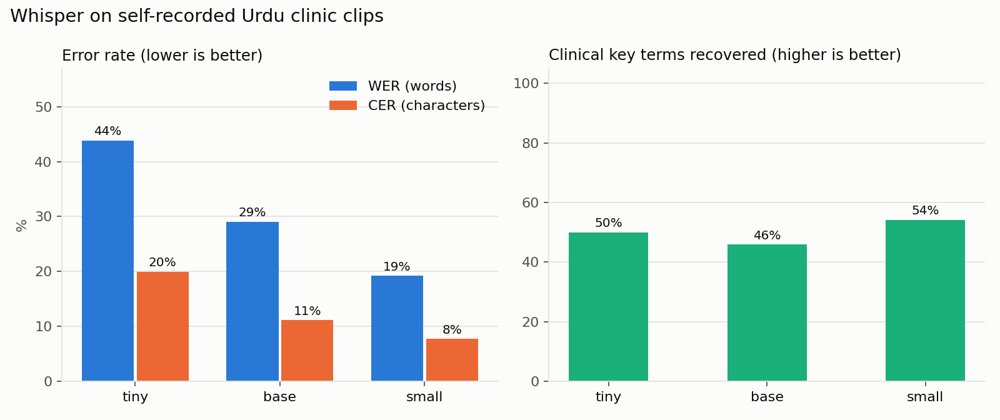

# Whisper on Urdu clinic speech: word error rate and clinical terms

**Research question:** On short Urdu doctor-patient conversations with everyday English medical words mixed in, how many words does Whisper (tiny, base, small) get wrong on a MacBook, and does it keep the clinically important words?

## Why it matters
Clinical documentation tools (live transcription, then an LLM drafts the note) are only as safe as the transcript. In Pakistan and in UK clinics with Urdu-speaking patients, consultations are spoken in Urdu mixed with English terms such as *X-ray*, *MRI*, *sugar* and *blood pressure*. Whisper ([Radford et al., 2022](https://arxiv.org/abs/2212.04356)) reports multilingual results on read-speech benchmarks such as FLEURS. It does not evaluate clinical conversation or code-switching, and the authors list skipped words and hallucinated text as known failure modes. A single missed word like *peshab* (urine) or *bukhar* (fever) can hide a red flag, so word error rate alone is not enough.

## Data
- Three fictional physiotherapy conversations written in Urdu script: lower back pain with red-flag questions, a twisted knee, and a frozen shoulder ([`data/references/`](data/references/)). About 200 words in total.
- Read aloud by me in my own voice and recorded at 16 kHz mono on the MacBook microphone. **No real patient data.** The audio stays on my machine and is not committed.
- [`data/key_terms.json`](data/key_terms.json): 24 clinical key terms (8 per clip) with accepted spellings in Urdu and Latin script, e.g. `ایم آر آئی` or `MRI`.

## Method
1. **Transcription:** [faster-whisper](https://github.com/SYSTRAN/faster-whisper) (CTranslate2), CPU, int8, `language="ur"`, beam size 5, temperature 0. Models: tiny, base, small.
2. **Normalisation** ([`urdu_text.py`](urdu_text.py)): Arabic yeh/kaf/heh mapped to Urdu forms, diacritics and punctuation removed, digits unified. The same function runs on the reference and the transcript, so keyboard differences are not counted as errors.
3. **Metrics** ([`metrics.py`](metrics.py)):
   - **WER** = (substitutions + deletions + insertions) / reference words, from a Levenshtein alignment.
   - **CER** on characters with spaces removed, because Urdu word spacing is inconsistent (`فزیوتھراپی` vs `فزیو تھراپی`).
   - **Key-term recall:** share of the 24 clinical terms that appear in the transcript.
   - **Real-time factor:** transcription time / audio length (below 1 means faster than real time).
   - **Language ID:** whether Whisper, left to guess, detects the clip as Urdu.
4. Results are pooled over clips (total errors / total reference words).

## Run
```bash
python3 -m venv .venv && source .venv/bin/activate
pip install -r requirements.txt
python -m pytest -q
python run_wer.py                 # records missing clips, then writes results/
python run_wer.py --models medium # optional, larger model
```
If `data/audio/clip1.wav` (or `.m4a`) is missing, the script opens a reading sheet and records it: Enter to start, Enter to stop. Whisper models download on first use (tiny ~75 MB, base ~145 MB, small ~480 MB).

## Results
_From my run on a MacBook M4 (16 GB). To be filled from `results/summary.md`._

| Model | WER | CER (no spaces) | Key terms recovered | Real-time factor | Auto-detected as Urdu |
|---|---|---|---|---|---|
| tiny | - | - | - | - | - |
| base | - | - | - | - | - |
| small | - | - | - | - | - |



Per-clip numbers: [`results/results.csv`](results/results.csv). Every word error with its reference and hypothesis: [`results/word_errors.csv`](results/word_errors.csv). Raw transcripts: [`results/transcripts/`](results/transcripts/).

## My observations
_To be added after the run._

## Limitations
- One speaker, three clips, read speech in a quiet room. Real consultations have two voices, interruptions, background noise and regional accents. These numbers are a smoke test, not a benchmark.
- The reference scripts were written before recording; small deviations while reading count as errors.
- Key-term matching accepts listed spellings only; a correct but unlisted spelling counts as a miss.
- Urdu vs Hindi script: if Whisper writes Devanagari, every word counts as wrong even when the sound was right. Language ID is reported to catch this.

## Next steps
- Add a second speaker and background noise (clinic fan, traffic) to measure robustness.
- Compare with `medium` and a Whisper model fine-tuned on Urdu.
- Feed the transcripts into the local LLM note-drafting step and check whether transcript errors change the red-flag section of the note.
